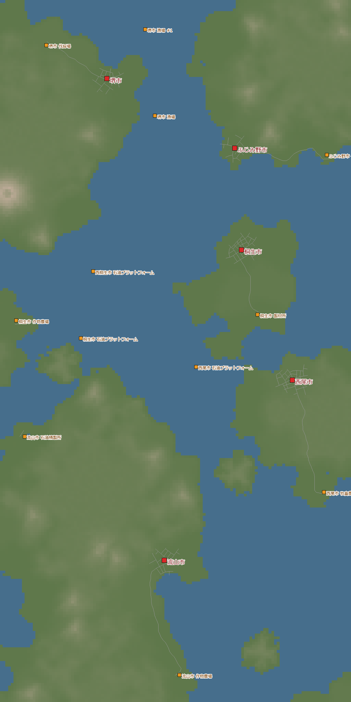
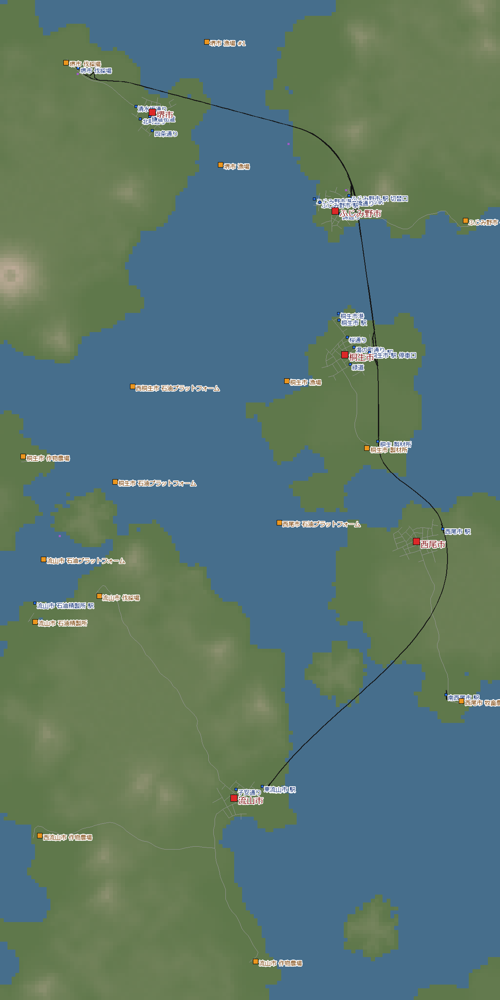
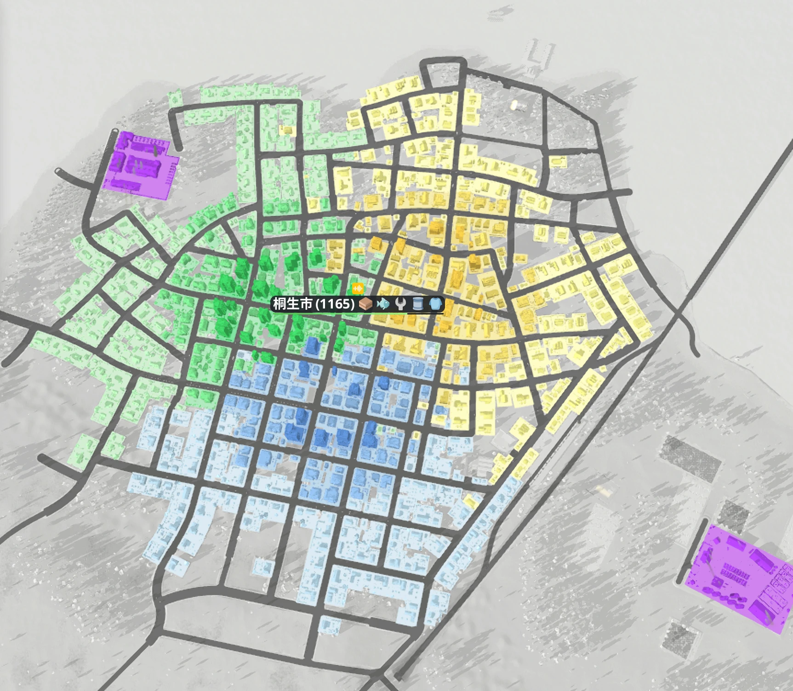
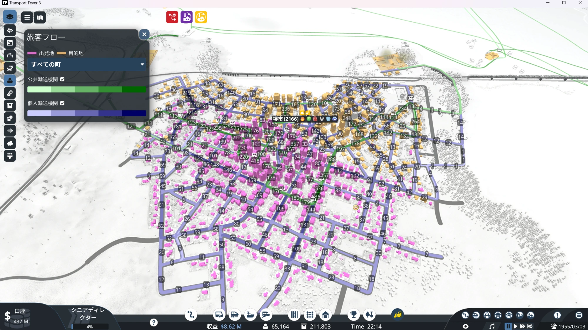
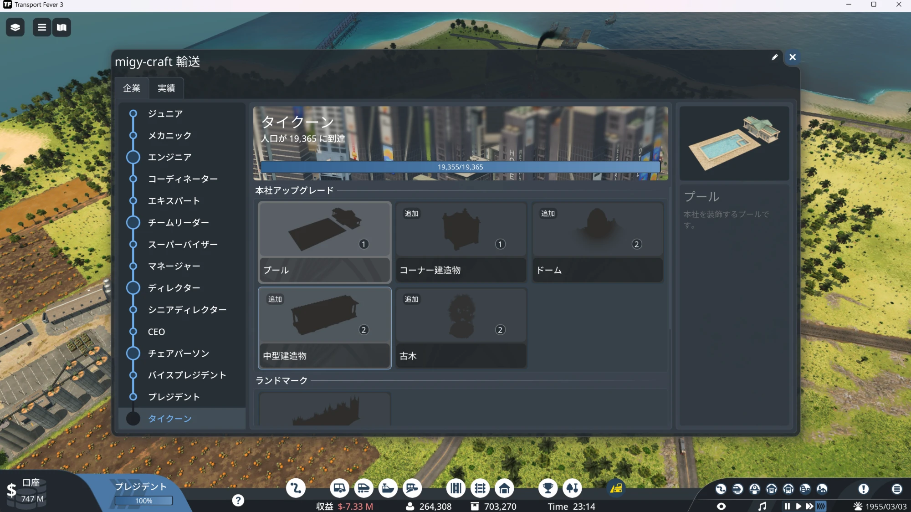
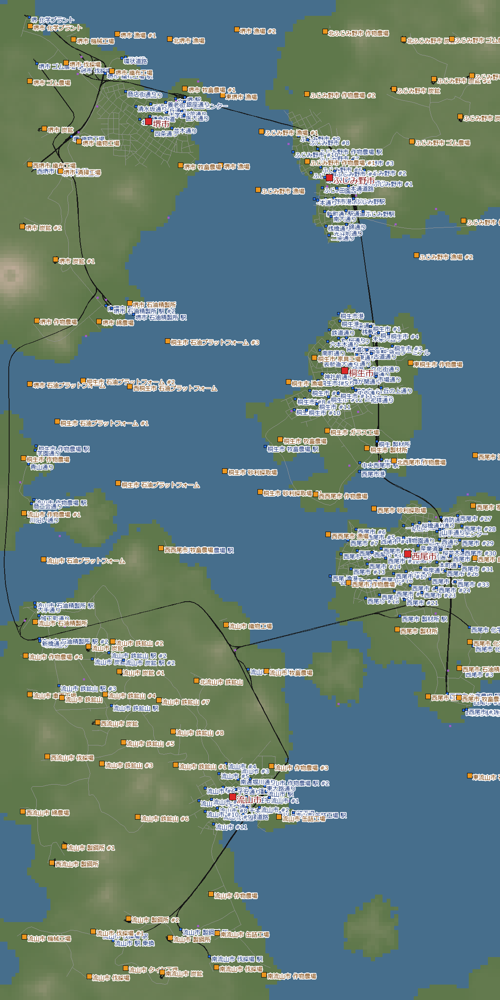

[日本語](../nagareyama.html) · [English](../en/nagareyama.html) · **Deutsch** · [中文](../zh/nagareyama.html) · [한국어](../ko/nagareyama.html)

Ein Bericht aus einem tropischen Archipel: Fünf Inselstädte, verbunden durch eine einzige Stammstrecke.
Ich habe 1930 begonnen, 1955 den Kalender angehalten und bis zum höchsten Firmenrang gespielt, dem „Tycoon“.

## Inhalt
- [Welteinstellungen](#settings)
- [Tag 1 – Eine Strecke verbindet die Inseln](#day1)
- [Tag 2 – Ölplattform und Schiffe](#day2)
- [Tag 3 – Den Kalender anhalten](#day3)
- [Tag 4 – Verschmutzung senken mit Boni](#day4)
- [Tag 5 – Stillstand, Stau und der Tycoon](#day5)
- [Tag 6 – Übrige Erfolge einsammeln](#day6)
- [Rückblick](#retro)

## Welteinstellungen

| Punkt | Einstellung |
|---|---|
| Klima | Tropisch |
| Karte | Mittel (8 × 16 km). Alle 5 Städte liegen auf verschiedenen Inseln |
| Städte, Industrien | Spärlich (5 Städte, 12 Industrien) |
| Schwierigkeit | Wie Normal (benutzerdefiniert) |
| Start | 1930 |
| Ziel | Das noch nicht gespielte Tropenklima spielen (Erfolg Weltenbummler), Tycoon |

Im Tropenklima gibt es Industrien, die es nur dort gibt.
Die Kette lautet: Gummiplantage → Reifenfabrik → Fahrzeugfabrik.
Dafür fehlen Getränke, Bücher, Zement, Ton, Papier und mehr.
Rohöl kommt nicht aus Bohrtürmen an Land, sondern von einer **Ölplattform** im Meer.

{: width="420"}

## Tag 1 – Eine Strecke verbindet die Inseln (1930–1933)

Das erste Geld kam mit Holz.
Ich habe zwei Züge eingesetzt: vom Holzfällerlager zum Sägewerk, weiter nach Kiryū und Fujimino.
Eine Dampflok mit 10 Rungenwagen bringt pro Jahr +$7.9M.

Parallel gingen zwei Schiffe von der Fischzucht zum Hafen von Fujimino.
Es gab zwei Subventionen für Fischlieferungen, und ich habe beide erfüllt.

1933 stand die erste Strecke zwischen den Städten.
Von der Insel Sakai über Fujimino, Kiryū und Nishio bis nach Nagareyama: eine Stammstrecke, die alle 5 Inseln von Süd nach Nord verbindet.

{: width="420"}

> **Erkenntnisse**
> - Liegen die Städte brav von Süd nach Nord, lässt sich eine Stammstrecke sorgfältig bauen. Ich musste keine Gleise bauen, die ich später ändern will
> - Neue Strecken gleich zweigleisig bauen und alle Signale am Tag des Baus auf „Einbahn“ stellen

## Tag 2 – Ölplattform und Schiffe (1934–1942)

Ich habe der Reihe nach geliefert, was die Städte wollen: Bretter, Fisch, Gemüse und Treibstoff.

Der Rohstoff für den Treibstoff, das Rohöl, kommt von der Ölplattform im Meer.
Schiffe bringen es zur Raffinerie, und von dort liefern 7 Schiffe den Treibstoff nach Nishio.
Ich habe auch einen Hubschrauber auf der Ölplattform landen lassen und damit den Erfolg Offshore bekommen.

Beim Gemüse sind es 12 Lkw und 2 Züge.
Unterwegs entstand auf der Insel Sakai eine neue Raffinerie, also habe ich den Treibstoff für Sakai von dort ausliefern lassen.

> **Erkenntnisse**
> - Schiffe nur dort einsetzen, wo man keine Gleise über das Meer legen kann. Einen großen Hafen von Anfang an zu bauen ist mühsam, und große Mengen langsam zu transportieren hat sich kaum gelohnt

## Tag 3 – Den Kalender anhalten (1955)

Ich habe den Kalender (das Fortschreiten des Datums) im Jahr 1955 angehalten.
Das Jahr bleibt stehen, nur Städte und Transport laufen weiter.
Gut daran: Dampfloks und Diesel dieser Zeit kann man in Ruhe genießen, ohne Zeitdruck.

In Fujimino habe ich Bretter und Fisch per Tram in die Stadt verteilt.
Aber es kamen weniger Bretter an als erwartet.
Beim Nachsehen zeigte sich: Ein Lager im Einzugsbereich der Haltestelle nahm alle Bretter an.
Nachdem ich das Lager aus dem Bereich genommen hatte, stieg die Versorgung mit Brettern von 44 % auf 82 %.

> **Erkenntnisse**
> - Liegt ein Lager im Einzugsbereich einer Haltestelle, schnappt es die Fracht weg, die eigentlich für die Stadt gedacht ist

## Tag 4 – Verschmutzung senken mit Boni (1955)

Die Städte wuchsen nicht mehr. Deshalb habe ich für jede Stadt nachgesehen, welche Bewertung das Wachstum bremst.
In vielen Städten zog die Verschmutzung der Verarbeitungsbetriebe die Werte herunter.

Mit den Boni, die es bei steigendem Firmenrang gibt, wollte ich die Verschmutzung senken.
- **Begrünen einer Industrie**: Senkt die Verschmutzung einer Industrie um 80 %. Ich habe es bei der Möbelfabrik in Kiryū und der Konservenfabrik in Nagareyama eingesetzt
- **Entschmutzungsanlage** (Anlage zur Verschmutzungsbeseitigung): Bau $220M, Unterhalt $10M pro Periode. Ich habe eine in Sakai gebaut, aber die Verschmutzung in Sakai änderte sich kaum (31 % → 33 %), also habe ich sie wieder abgerissen

> **Erkenntnisse**
> - Boni erst nach Preis und Wirkungsbereich einsetzen. Begrünen (−80 %) ist viel billiger und zuverlässiger

## Tag 5 – Stillstand, Stau und der Tycoon (1955)

Ich habe die Linie geändert: nicht erst alle Anfangsfrachten komplett liefern und dann verarbeiten, sondern zuerst verarbeiten.
Außerdem habe ich den Personenzug „Sakai – Fujimino“ gestartet. Er pendelt zwischen 5 Bahnhöfen und bringt +$17.9M pro Jahr.

Über Nacht liefen die Dinge allein weiter: Die Einwohnerzahl stieg von 9,648 auf 16,244, das Konto von $331M auf $1,079M.

### Stillstand bei der Bahn

Im Aufwind habe ich die Züge auf einen Schlag von 17 auf 23 erhöht.
Am Nachmittag erreichte dann fast zwei Stunden lang der Großteil der Züge keinen Bahnhof mehr.
Das Konto fiel von $1,057M auf $672M. Rund $385M waren weg.
Es staute sich wohl an den Bahnhöfen mit vielen Wendeverkehren (Sakai 6 Linien, Nagareyama 5 Linien).
Erst als ich zwei Personenzüge verkauft hatte, ging es wieder los.

### Stau in Kiryū

Diesmal staute es sich in der Stadt, und die Lkw kamen nicht mehr durch.
Die Bewertung des Verkehrsflusses in Kiryū war auf 29 % gefallen (traffic rating).

Der Grund war die Straße, die ich zwischen den Inseln gebaut hatte.
Menschen, die in die Nachbarstadt wollten, fuhren mit dem Auto und füllten die Stadt.
Ich habe die Straße gekappt, sodass man zwischen den Städten nur noch mit dem Zug reisen kann.

| Kiryū | Vor dem Kappen | Danach |
|---|---|---|
| Stau-Bewertung (traffic rating) | 29 % | 96 % |
| Nutzung des öffentlichen Verkehrs (public transport usage) | 28 % | 56 % |
| Wachstumsstufe der Stadt (town growth level) | 1 | 2 |

### Tycoon

Der Firmenrang steigt mit der Weltbevölkerung.
Der Tycoon verlangt in dieser Welt „19,365 Einwohner“.
Um 23:14 Uhr war es endlich so weit. Das war der Erfolg Karriereleiter.

> **Erkenntnisse**
> - Züge einzeln hinzufügen und nach jedem Zug nachsehen. Auf einmal viele hinzuzufügen führt zu Stau an den Wendebahnhöfen
> - Verbindet man Städte per Straße, verstopfen die Autos Richtung Nachbarstadt die Stadt. Besser Städte nur mit Zug oder Schiff verbinden und die Straßen zwischen den Städten kappen
> - Die nötige Einwohnerzahl für den Tycoon ist pro Welt verschieden (sie hängt von der Anfangsbevölkerung ab). Am ersten Tag das Ziel im Firmenfenster ansehen

## Tag 6 – Übrige Erfolge einsammeln

Nach dem Tycoon habe ich die restlichen Erfolge eingesammelt.

- **Passagierpionier** (insgesamt 1 Million Passagiere): Schon durch die Summe der früheren Welten erreicht. Das Spiel zählt über Welten hinweg
- **Vertriebsmeister** (alle Frachten liefern, die in jedem Klima vorkommen): Es fehlten zwei, die es nur in den Tropen gibt: Reifen und Fahrzeuge. Ich habe Gummi → Reifenfabrik → Fahrzeugfabrik transportiert und die Fahrzeuge in eine Stadt geliefert. Erfolg erreicht

{: width="420"}

## Rückblick

### Das hat Spaß gemacht
- Das Ziel „Inseln verbinden“ war leicht zu verstehen
- Die Städte lagen günstig, und ich konnte eine Stammstrecke sorgfältig bauen
- Mit angehaltenem Kalender konnte ich die Loks der Zeit in Ruhe genießen
- Ich habe Zahlen aufgeschrieben und beim Spielen gesehen, was jeder Stadt fehlt

### Das nehme ich mit
- Städte nicht per Straße verbinden (Straßen zwischen den Städten kappen)
- Züge einzeln hinzufügen
- Am ersten Tag die Einwohnerzahl ansehen, die der Tycoon braucht
- Will eine Stadt Zweitprodukte, lieber Primärgüter zur Verarbeitung schicken als in die Stadt zu liefern (man will die Stadt zwar gern selbst gut beliefern)

Als Nächstes: das Trockenklima auf Leicht. Außerdem suche ich die Tiere, die ich noch nicht gesehen habe (Puma, Adler).
