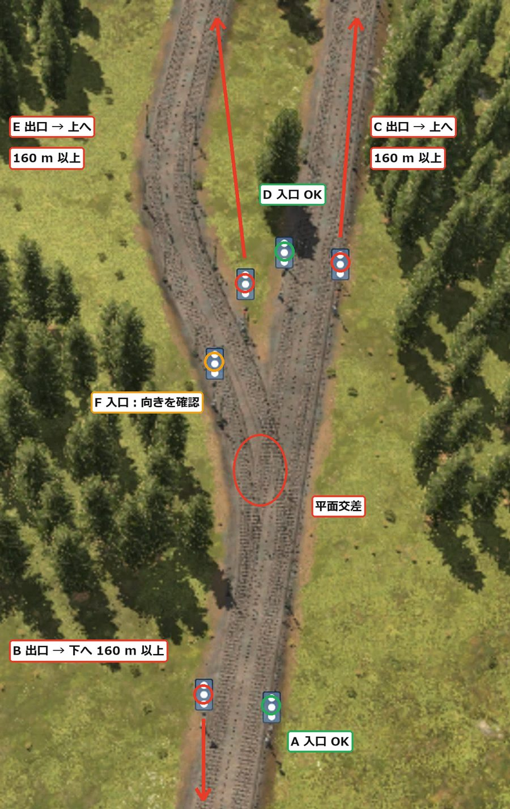
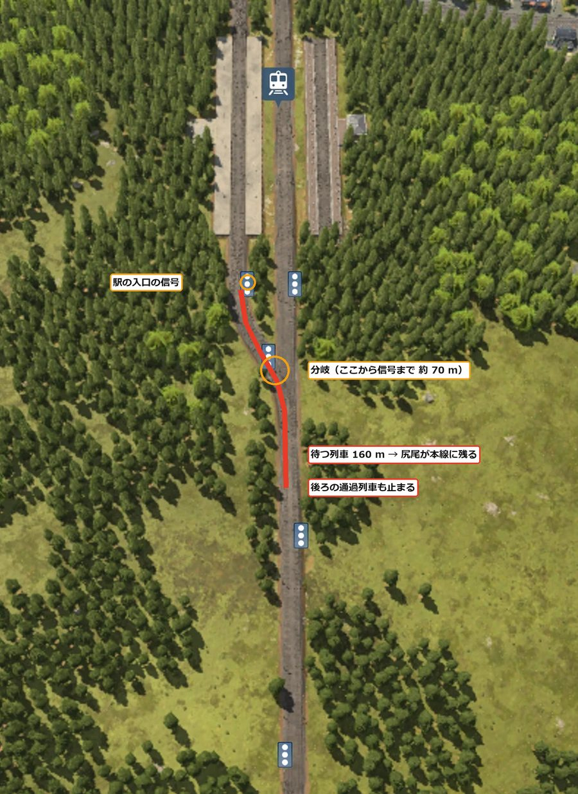
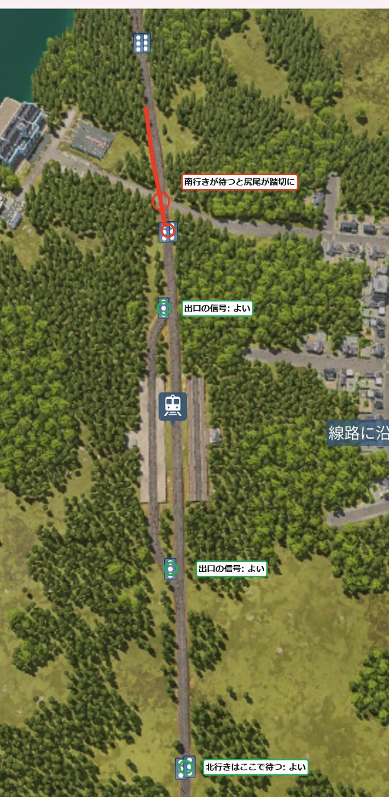

[日本語](../tottori.html) · [English](../en/tottori.html) · **Deutsch** · [中文](../zh/tottori.html) · [한국어](../ko/tottori.html)

Ein Bericht darüber, wie ich fünf Städte rund um einen großen See im subarktischen Klima mit dem Zug verbinde.
Ich habe 1960 begonnen. Das wichtigste Ziel diesmal: zu lernen, Bahnhöfe und Signale so zu bauen, dass das, was mich beim letzten Mal am meisten geärgert hat, „lange Züge verstopfen das Gleis“, nicht mehr passiert.

## Inhalt
- [Welteinstellungen](#settings)
- [Tag 1 – Das Muster für Bahnhof und Signale neu durchdenken](#day1)

## Welteinstellungen

| Punkt | Einstellung |
|---|---|
| Klima | Subarktisch |
| Karte | Mittel (8 × 16 km). Ein großer See in der Mitte |
| Städte, Industrien | Spärlich (5 Städte, 12 Industrien) |
| Schwierigkeit | Einfach (Fahrzeuge, Bau und Unterhalt zum halben Preis). Empfindlichkeit der Stadtbewertung aus |
| Start | 1960 |
| Ziel | Tycoon im 3. Klima, ein Betrieb, der Züge nicht verstopft, Pendeln und Umsteigen mit dem Zug |

Alle fünf Städte liegen in einer Reihe am West- bis Südufer des Sees, von Nordwesten nach Südosten.
Die meisten Industrien liegen auf der Ostseite des Sees. Im Südwesten gibt es Berge von 200–298 m Höhe.

## Tag 1 – Das Muster für Bahnhof und Signale neu durchdenken (1960–1961)

### Zuerst die Zuglänge festlegen

Das größte Problem im letzten Spiel, Yachiyo, waren verstopfte Strecken durch lange Züge.
Ich hatte Züge von etwa 205 m an 160-m-Bahnsteigen halten lassen; das überstehende Ende blockierte eine Weiche, und eine wichtige Industrie stand still.

Zuerst hatte ich geplant, mit „240-m-Bahnsteigen und mindestens 300 m Abstand zwischen den Signalen“ zu bauen.
Dafür braucht man aber viel ebenes Land. Auf dieser Karte mit vielen Bergen und Seen geht das nicht.

Also habe ich beschlossen, stattdessen die Zuglänge kürzer festzulegen.

- Auf allen Linien passt der Zug an einen 160-m-Bahnsteig (eine Lok mit etwa 3.000 kW plus 10–11 Wagen, die im Jahr etwa 150 befördern)
- Pro Bahnhof 400 m Fläche einplanen (160 m Bahnsteig plus je 110 m Weichen an beiden Enden)
- Was fehlt, durch mehr Züge ausgleichen, nicht durch längere
- Auch im Personenverkehr kurze Züge öfter fahren lassen, um die Taktfrequenz zu erhöhen

### Signale an einer Weiche

Von der zweigleisigen Hauptstrecke habe ich das Gleis zu einem Bahnhof nach links abzweigen lassen (Rechtsverkehr).
Das Signal vor der Weiche ist richtig platziert, wenn es direkt vor der Weiche steht.
Aufpassen muss man beim Signal hinter der Weiche. Steht es gleich hinter der Weiche, bleibt das Ende eines dort haltenden Zuges auf der Weiche.
Solange das so ist, kann auch ein Zug in Gegenrichtung die Weiche nicht passieren. Das Signal hinter der Weiche kommt mindestens eine Zuglänge (160 m) weiter hinten.

{: width="420"}

### Braucht man vor und hinter einem Bahnhof lange Geraden?

Ich hatte vor und hinter den Bahnhöfen lange Geraden eingeplant, wollte aber kompakter bauen.
Bei genauem Hinsehen ist die Länge nur nötig, „wenn das Ende eines vor einem Signal wartenden Zuges in eine Weiche reicht, die andere Züge befahren“.
Der Wartebereich darf gekrümmt sein oder an einer Steigung liegen.

Die Weichen an beiden Enden eines Bahnhofs (40 m Doppelkreuzungsweiche plus 70 m Zusammenführung) liegen hinter dem Einfahrsignal.
Deshalb zählen sie nicht zur Länge des Wartebereichs.

Im Bahnhof Hadano habe ich die Weiche dicht an den Bahnsteig gerückt.
Dann sind es vom Signal vor dem Bahnsteig bis zur Weiche nur etwa 70 m.
Steht ein Zug am Bahnsteig, wartet der nächste an diesem Signal. Das Ende des 160-m-Zuges bleibt hinter der Weiche auf der Hauptstrecke, und sogar der durchfahrende Zug dahinter wird gestoppt.

{: width="420"}

### Kein Signal an der Einfahrt

Der Bahnhof Hadano hat von Haus aus 2 Bahnsteige und 2 Gleise; fährt ein Zug an den freien Bahnsteig, gibt es keinen wartenden Zug.
Deshalb habe ich die Signale anders gesetzt.

- Bisher: je ein Signal vor der Doppelkreuzungsweiche an beiden Enden des Bahnhofs
- Jetzt: nur ein Signal direkt vor der Ausfahrtsweiche, auf der Seite, auf der im Rechtsverkehr die Züge den Bahnhof verlassen. An der Einfahrt keines (versetzt)

Ein einfahrender Zug wartet am Signal des vorherigen Blocks. Dort reicht sein Ende nicht an die Weiche des Bahnhofs.
Beim Weiterfahren wählt er den freien Bahnsteig und fährt ein.
Ein ausfahrender Zug wartet am Ausfahrsignal im Bahnsteig stehend, blockiert also die Hauptstrecke nicht.

{: width="420"}

An genau einer Stelle gilt: Wartet ein Zug Richtung Süden am nördlichen Signal, reicht sein Ende in den Bahnübergang einer Straße.
Autos können dann nicht passieren, doch ich habe beschlossen, erst eine Überführung zu bauen, wenn es zum Problem wird.

> **Was ich gelernt habe**
> - Legt man zuerst die Zuglänge fest, ergeben sich Bahnsteig- und Flächenlänge. Mehr Züge brauchen weniger Land als längere Züge
> - Das Signal hinter einer Weiche mindestens eine Zuglänge entfernt setzen. Bleibt das Ende eines haltenden Zuges auf der Weiche, steht auch die Gegenrichtung
> - Länge ist nur nötig, wenn das Ende eines wartenden Zuges in eine Weiche reicht, die andere Züge befahren. Der Wartebereich darf gekrümmt sein oder an einer Steigung liegen
> - Bei einem Zwischenbahnhof mit 2 Bahnsteigen und 2 Gleisen wird er kürzer, wenn man an der Einfahrt kein Signal setzt und nur eines direkt vor der Ausfahrt. Prüfen, ob hinter dem vorherigen Signal keine Weiche und kein Bahnübergang liegt
> - Ich stelle mir Signale so vor, dass sie einen Abschnitt, den ein Zug passiert hat, sofort freigeben und andere Züge durchlassen (noch nicht bestätigt)
