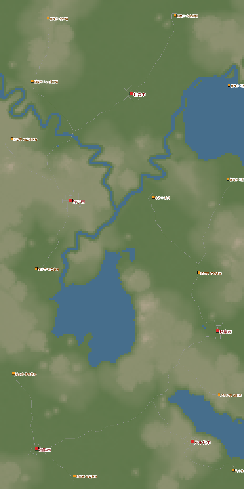
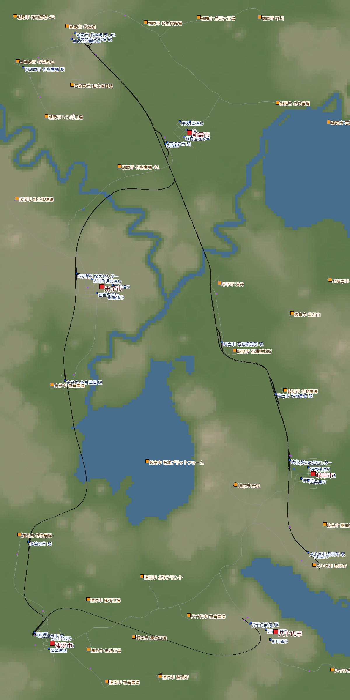
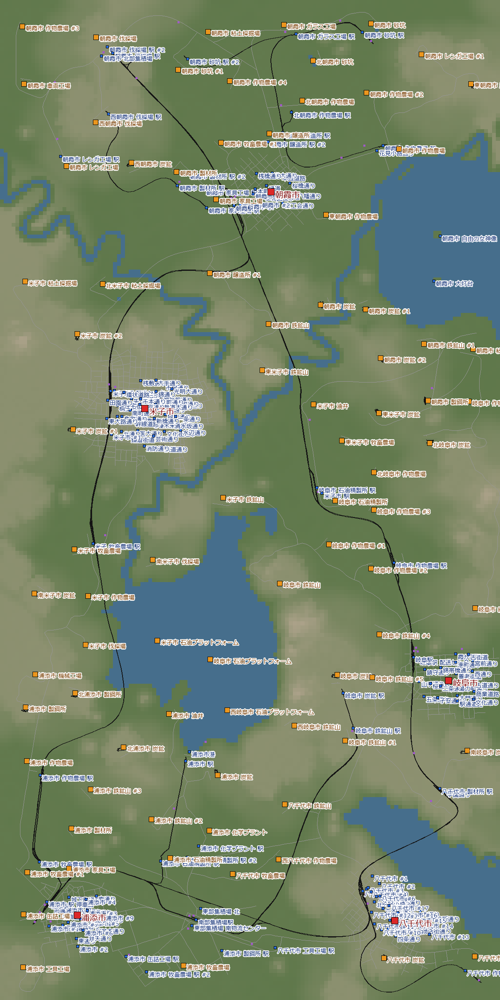

[日本語](../yachiyo.html) · [English](../en/yachiyo.html) · **Deutsch** · [中文](../zh/yachiyo.html) · [한국어](../ko/yachiyo.html)

Ein Bericht aus dem Trockenklima: Fünf Städte, verstreut über ein Plateau und das Tiefland, verbunden durch eine Stammstrecke für Holz und Sammellager.
Ich habe 1950 begonnen, einmal neu angefangen und 1985 den höchsten Firmenrang erreicht, den „Tycoon“. In Echtzeit waren es 4 Tage.

## Inhalt
- [Welteinstellungen](#settings)
- [Tag 1 – Das Konto im Minus, also neu anfangen](#day1)
- [Tag 2 – Die Holz-Stammstrecke und Sammellager](#day2)
- [Tag 3 – In jeder Stadt lösen, was das Wachstum bremst](#day3)
- [Tag 4 – Laufen lassen, und der Tycoon](#day4)
- [Rückblick](#retro)

## Welteinstellungen

| Punkt | Einstellung |
|---|---|
| Klima | Trocken |
| Karte | Mittel (8 × 16 km). Seen, Flüsse, Berge normal |
| Städte, Industrien | Spärlich (5 Städte, 13 Industrien) |
| Schwierigkeit | Einfach (Fahrzeuge, Bau und Unterhalt zum halben Preis) |
| Start | 1950 |
| Ziel | Das noch nicht gespielte Trockenklima spielen, Tycoon (19,415 Einwohner) |

Im Trockenklima fehlen unter anderem Zementwerk, Fischzucht, Papierfabrik und Reifenfabrik.
Das Gelände hat zwei Stufen: ein Plateau auf etwa 165 m Höhe und das Tiefland auf etwa 14 m.
Yonago und Yachiyo liegen auf dem Plateau, die anderen drei Städte im Tiefland.

{: width="420"}

## Tag 1 – Das Konto im Minus, also neu anfangen (1950–1951)

Ich spiele meistens nach demselben Muster.
1. Am Anfang eine Strecke bauen, die gut Geld bringt: „Holz → Sägewerk“ oder „Rohöl → Treibstoff“
2. Sie sorgfältig als Stammstrecke ausbauen und bis etwa zum Tycoon weiter nutzen

So wollte ich es auch diesmal machen und das Holzfällerlager am Nordrand mit dem Sägewerk im Süden verbinden.
Aber selbst mit dem ganzen Geld aus den Darlehen reichte es nicht, und das Kapital war aufgebraucht.
Wegen des Höhenunterschieds zwischen Plateau und Tiefland wurde es viel teurer als gedacht.

Als ich die Gleise mit dem Bulldozer abgerissen habe, kam nur ein Teil des Geldes zurück.
Mein Geld war auf fast die Hälfte geschrumpft.

Notgedrungen habe ich das nahe Lehm → Ziegel verbunden und die Ziegel in eine Stadt geliefert.
Aber ohne genug Startkapital für den Ausbau konnte ich viel zu wenig tun.
Auch eine Subvention für den Transport von Arbeitern habe ich ohne passende Linie angenommen. Sie ist gescheitert, und durch die Strafe fiel das Konto auf −$19.8M.

An diesem Punkt habe ich beschlossen, mit demselben Seed ab 1950 neu anzufangen.

> **Erkenntnisse**
> - Gleise über Höhenunterschiede sind viel teurer als gedacht. Bei einer langen Stammstrecke vor dem Bau die Kosten abschätzen
> - Reißt man Gleise ab, bekommt man nur etwa die Hälfte der Baukosten zurück
> - Die Vorauszahlung einer Subvention ist kein Verdienst. Erst annehmen, wenn eine Linie läuft, die die Bedingungen erfüllt

## Tag 2 – Die Holz-Stammstrecke und Sammellager (1950–1955)

Beim Neustart habe ich eine Holzstrecke vom Holzfällerlager im Norden bis zum Sägewerk im Südosten gebaut.
Diesmal nicht gerade und auf gleicher Höhe, sondern über das Gelände, wo der Bau am billigsten war: eine kurvige Stammstrecke.
Sie wurde zur **Stammstrecke**: Die Industrien jeder Gegend sammle ich zuerst in **Sammellagern** und lade die Fracht dann auf die Stammstrecke.
Auch bei den Gleisen habe ich billige Typen gewählt.

Der Höhenunterschied zwischen Plateau und Tiefland ist groß, und die Brücke über das Tal zwischen Yachiyo und Gifu war sehr teuer.
Trotzdem war es Einfach, deshalb hat es dem Spiel kaum geschadet, wenn ich Anlagen etwas nachlässig gebaut habe.

Da die Welt 1950 beginnt, ging es diesmal nicht mit Pferdefuhrwerken los.
Von Anfang an gab es Lkw und elektrifizierte Gleise. Die Loks mit viel Kapazität und Tempo waren eine große Hilfe.

1955 hatte ich $262M auf dem Konto, kein Darlehen mehr und 27 Linien.
Die besten Verdiener waren der Zug für Holz + Gemüse (+$9.0M pro Jahr) und die Personenlinie „Asa-Yone-Linie“ (Asaka – Yonago, +$6.2M pro Jahr).

{: width="420"}

### Meine Regeln beim Gleisbau

Vorletzte Welt konnte ich meine Linien in der Inflationszeit nicht in die Gewinnzone bringen, das Geld ging langsam aus, und ich habe aufgegeben.
Der Grund waren die Baukosten. Weil etwas Geld da war, hatte ich großzügig Hochgeschwindigkeitsgleise, Standardgleise und Lager gebaut.
Deshalb war ich letztes Mal und diesmal vorsichtig.

Bei Fracht hängt der Preis nicht von der Liefergeschwindigkeit ab.
Tempo wie 160 km/h muss man nur bei Passagieren halten.
Also habe ich klare Regeln für den Gleisbau festgelegt.

- Nicht alles mit Standardgleisen bauen
- Weizen, Lehm, Sand, Eisenerz, Kohle und Ähnliches braucht man in großen Mengen, also auch auf kurzen Wegen (wenn möglich) per Zug
- Bevor ich ein Lager hinzufüge, überlegen, ob schnell kreisende Liefer-Lkw verhindern können, dass sich zu viel Fracht staut
- Vor dem Bahnhof eine Lkw-Station o. Ä. bauen und keine Straßen anlegen
- Sammellager bauen und dort viele Züge und Lkw ein- und ausfahren lassen
- Die Linien in der Stadt nicht zu stark nach Fracht aufteilen. Lade- und Lieferorte so planen, dass dieselbe Linie mit denselben Fahrzeugen jede ankommende Fracht transportieren kann
- Privatautos stören, also nicht an die Hauptstraßen der Stadt anschließen, auf denen der normale Verkehr fährt

### Arbeiter im Güterzug mitnehmen

Bei den ersten Primärindustrien (Holzfällerlager, Farmen usw.) will ich die Produktion steigern, deshalb plane ich auch gleich, wie Arbeiter dorthin kommen.
Eine Busverbindung zur nahen Stadt funktioniert gut, aber diesmal habe ich von Anfang an etwas anderes versucht: Personenwagen vorne an den Güterzug hängen und die Arbeiter mitnehmen.

Dazu lässt man an einem Bahnsteig Passagiere und Fracht zu und setzt die Bahnsteige der Reihe nach als Halte der Linie.
Aber die Linien werden kompliziert.
Und auf der Stammstrecke klappte es nicht gut: Die Leute fuhren über ihr Ziel hinaus, um an der Endstation zu wenden.
Am Ende kam ich zum Tycoon, ohne den Pendelverkehr der Arbeiter gut hinzubekommen.

> **Erkenntnisse**
> - Baut man zuerst eine lange Stammstrecke, wächst das Netz allein dadurch, dass man Sammellager daran anhängt
> - Gemüse, Bretter, Treibstoff, Fleisch und Ziegel ließen sich damit gut herstellen und liefern
> - Güterstrecken mit billigen Gleisen bauen. Geld für Tempo nur bei Passagieren ausgeben
> - Arbeiter in Personenwagen am Güterzug zu befördern macht die Linien kompliziert, und auf der Stammstrecke fahren die Leute über ihr Ziel hinaus. Für den Pendelverkehr will ich eine andere Form versuchen

## Tag 3 – In jeder Stadt lösen, was das Wachstum bremst (1966–1967)

1966: 10,551 Einwohner, Konto $2.02B.
Das Bevölkerungswachstum war etwa 2.8-mal so hoch wie 1955.

Eine Stadt hört bei ihrer niedrigsten Bewertung auf zu wachsen. Stadt für Stadt angesehen, bremste überall etwas anderes.

| Stadt | Bewertung, die das Wachstum bremste | Was ich getan habe |
|---|---|---|
| Gifu | Verkehr (Privatautos verstopfen die Hauptstraße im Zentrum) | Die Tram auf zwei Linien aufgeteilt und auch durch die Westhälfte geführt |
| Gifu, Yachiyo | Stadtpflege (urban care) | Die unterbrochene Hauptverbindung zwischen Gifu und Yachiyo wiederhergestellt |
| Yachiyo | Verkehr | Eine Personen-Tram in der Südhälfte |
| Asaka | Verschmutzung | Beschlossen, alle Wahrzeichen hier zu bauen |

Die Verkehrsbewertung in Gifu stieg von 0.42 auf 0.74, die Nutzung des öffentlichen Verkehrs von 0.09 auf 0.26.
Das Wachstum erreichte rund 635 Einwohner pro Stunde, das schnellste in dieser Welt.

Alle Wahrzeichen außer dem Schifffahrtsmuseum brauchen „Stein“.
Auch wenn es auf der Karte keinen Erzeuger für das Material gibt, ist das kein Problem. Baut man ein Wahrzeichen, entsteht nach einer Weile eine neue Industrie, die das nötige Material herstellt.

### Was tun gegen Stau

Das ist mein aktueller Stand.

1. **Als grobe Lösung die Verbindung zwischen den Städten kappen**. Das Wachstum stoppt, aber die Strafe ist nicht so schwer. Man kann wohl erst das Netz ordnen, den Stau auflösen und dann wieder verbinden
2. **Zweispurige Straßen zu Busspuren machen**. Normale Autos können sie nicht benutzen, und Gebäude sind nicht betroffen. Gut, wenn steckengebliebene Lkw und Trams erst einmal weiterfahren sollen
3. Die eigentliche Lösung ist wohl nur ein guter öffentlicher Verkehr. Wie das gut gelingt, weiß ich aber noch nicht genau

Über Verschmutzung und Lärm beschweren sich die Städte kaum, solange man fleißig liefert und genug Waren bringt.
Darüber nachdenken muss man wohl erst, wenn sich die Lieferung nicht weiter verbessern lässt.
Trotzdem lohnt es sich wohl, Folgendes von Anfang an zu beachten.
- Bahnhöfe nicht in Wohngebiete setzen
- Straßen zwischen den Städten, Hauptstraßen der Stadt und Baublöcke wenigstens grob ordnen, damit sich Tramgleise sauber verlegen lassen

> **Erkenntnisse**
> - Stau kommt von Privatautos. Nicht die Lkw reduzieren, sondern mit Personenlinien die Nutzung des öffentlichen Verkehrs erhöhen
> - Fällt die Stadtpflege plötzlich, nachsehen, ob eine Hauptverbindung zwischen den Städten unterbrochen ist

## Tag 4 – Laufen lassen, und der Tycoon (1968–1985)

Ab 1969 habe ich das Spiel fast nur noch laufen lassen.
Seit dem Jahr, in dem ich eine neue Güterstrecke nach Yonago gebaut hatte, wurden Lärm und Verkehr in Yonago schlechter, und das Wachstum fiel auf rund 230 Einwohner pro Stunde.
Trotzdem waren es 1985 schon 19,233 Einwohner. Es fehlten nur noch 182.

Und dann: 19,415 Einwohner. Ich war Tycoon.
Nach den Tropen in 08 war das der Tycoon im zweiten Klima.

{: width="420"}

Während das Spiel lief, hatten sich aber auch Probleme angebahnt.
Lange Züge stauten sich vor den Bahnhöfen, die wichtigsten Produktionsbetriebe standen still, und viele haben geschlossen.
Zwischen 1967 und 1985 sind 29 Industrien verschwunden und 27 neu entstanden.

> **Erkenntnisse**
> - Ist ein Zug länger als der Bahnsteig, steht sein Ende auf der Weiche und hält die Züge dahinter auf. Die Industrien dahinter schließen dann
> - Der verbleibende Engpass beim Wachstum ist die Verteilung in der Stadt. Auch wenn der Transport zwischen den Städten steht: Fehlen Linien vom Lager in die Stadt, stapelt sich die Fracht im Lager

## Rückblick

### Das hat Spaß gemacht
- Sammellager an die Holz-Stammstrecke anzuhängen, ließ das Netz sauber wachsen
- Mit Mühe über den Höhenunterschied zwischen Plateau und Tiefland: eine Brücke über das Tal verbindet beide
- Auf Einfach konnte ich spielen, ohne mir zu viele Gedanken über die Platzierung zu machen
- Start 1950: von Anfang an Lkw und elektrifizierte Strecken. Ich konnte mit zuverlässigen Loks beginnen

### Das nehme ich mit
- Bei einer langen Stammstrecke vor dem Bau die Kosten abschätzen (Höhenunterschiede sind teuer)
- Güterstrecken mit billigen Gleisen bauen. Geld für Tempo nur bei Passagieren ausgeben
- Subventionen erst annehmen, wenn eine Linie läuft, die die Bedingungen erfüllt
- Stehen Stammstrecke und Sammellager, zuerst die Verteilung in der Stadt aufbauen
- Für jede Linie zuerst den längsten Zug festlegen. Bahnsteige länger als dieser Zug, und auch das Stück vom Ende einer Weiche bis zum nächsten Signal länger als dieser Zug (damit das Ende eines haltenden Zuges nie die Weiche blockiert)
- Schon früh Arbeiter per Zug pendeln lassen und sie mit Umsteigen bis zu den Industrien bringen

Als Nächstes: das subarktische Klima, mit ausgeschalteter Empfindlichkeit der Stadtbewertungen, einer Einstellung, bei der die Bevölkerung sehr stark wächst.
Bisher war 160 m meine Standardlänge für Bahnsteige, aber der Shinkansen Baureihe 0 ist mit 8 Wagen über 200 m lang.
Deshalb baue ich die Gleise nächstes Mal von Anfang an für lange Züge und will lernen, lange Züge und Trams ohne Stau zu betreiben.
(Übrigens: Die Baureihe 0 ist mit 6 Wagen etwa 154 m lang und passt an einen 160-m-Bahnsteig. 8 Wagen braucht man nur bei sehr vielen Fahrgästen.)
Außerdem ziele ich auf Centralized (alle 10 Wahrzeichen) und Summit Stopover (ein Bahnhof über 500 m Höhe).
