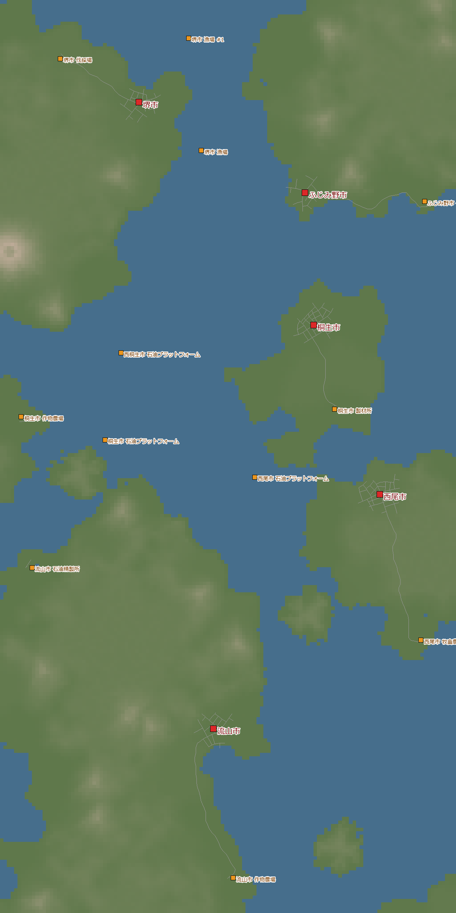
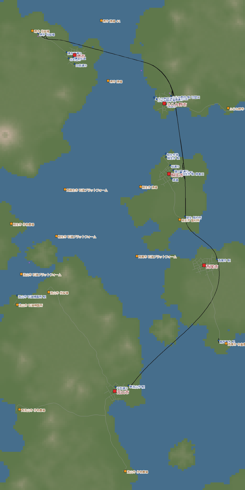
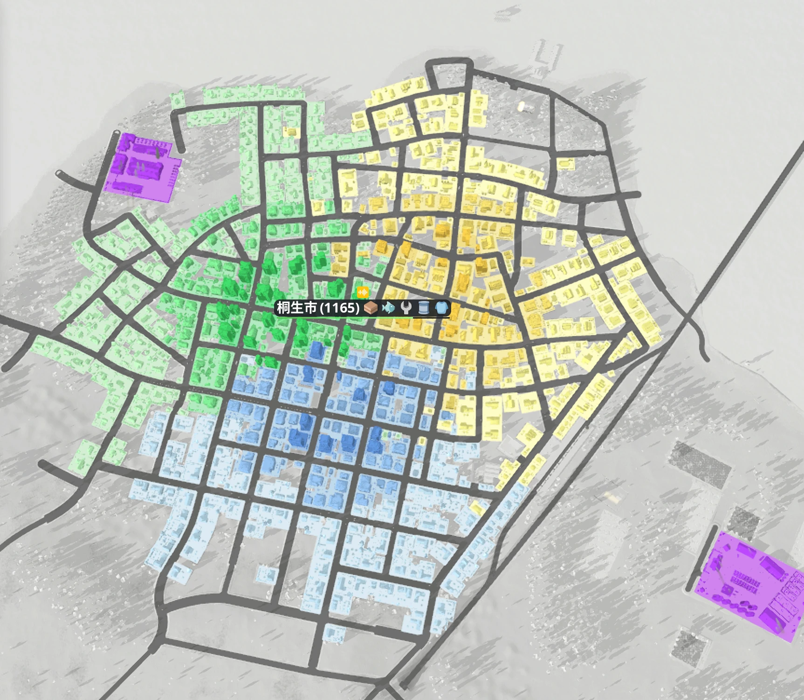
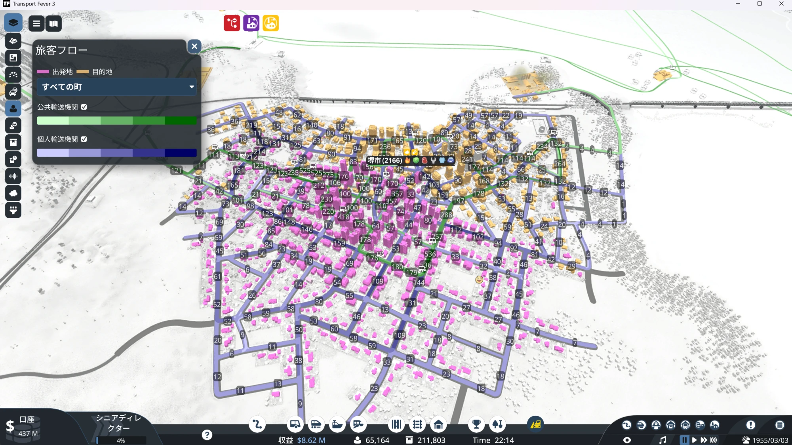
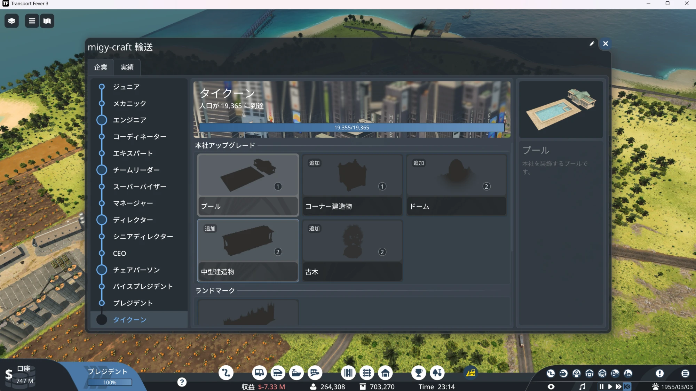
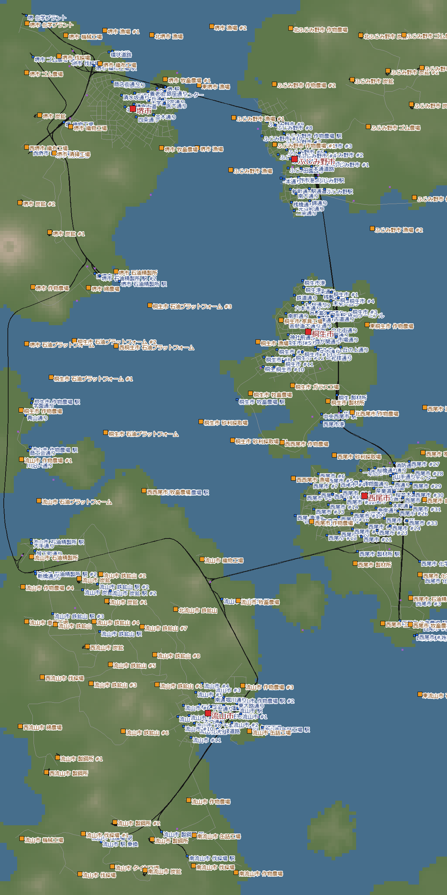

[日本語](../nagareyama.html) · **English** · [Deutsch](../de/nagareyama.html) · [中文](../zh/nagareyama.html) · [한국어](../ko/nagareyama.html)

This is the story of linking five island towns with a single trunk line in a tropical archipelago.
I started in 1930, stopped the calendar in 1955, and played until my company reached the top rank, Tycoon.

## Contents
- [World settings](#settings)
- [Day 1 — One railway to link the islands](#day1)
- [Day 2 — Oil platforms and ships](#day2)
- [Day 3 — Stopping the calendar](#day3)
- [Day 4 — Cutting pollution with perks](#day4)
- [Day 5 — Gridlock, traffic jams, and Tycoon](#day5)
- [Day 6 — Picking up the remaining achievements](#day6)
- [Looking back](#retro)

## World settings

| Item | Setting |
|---|---|
| Climate | Tropical |
| Map | Medium (8 × 16 km). All five towns sit on separate islands |
| Towns and industries | Sparse (5 towns, 12 industries) |
| Difficulty | About Normal (custom) |
| Start | 1930 |
| Goals | Play the tropical climate I hadn't tried yet (Globetrotter achievement), and reach Tycoon |

The tropics have industries found nowhere else:
Rubber Farm → Tire Factory → Vehicle Factory.
On the other hand, beverages, books, cement, clay, paper and a few others never appear.
Crude oil comes not from wells on land but from **Oil Platforms** out at sea.

{: width="420"}

## Day 1 — One railway to link the islands (1930–1933)

My first income came from logs.
I ran two trains from the Logging Camp to the Saw Mill, then on to Kiryū and Fujimino.
A steam locomotive pulling 10 stake wagons earned $7.9M a year.

At the same time I put two ships between a Fishing Ground and the port of Fujimino.
There were two subsidies for delivering fish, and I completed both.

By 1933 one intercity line was finished.
It runs north to south through all five islands: Sakai's island → Fujimino → Kiryū → Nishio → Nagareyama.

{: width="420"}

> **What I learned**
> - When the towns line up neatly north to south, you can build one trunk line carefully, without "fix it later" track
> - Build new lines double-tracked from the start, and set every signal to one-way on the day you lay it

## Day 2 — Oil platforms and ships (1934–1942)

I worked through what the towns wanted: planks, fish, vegetables and fuel.

Fuel starts as crude oil from the Oil Platforms at sea.
Ships carried it to the refinery, and seven more ships took fuel from the refinery to Nishio.
I also landed a helicopter on an Oil Platform and got the Offshore achievement.

Vegetables went by 12 trucks and 2 trains.
Midway, a new Oil Refinery appeared on Sakai's island, so I rearranged things to supply Sakai's fuel from there.

> **What I learned**
> - Keep ships for crossings where rail can't go. Building a big port from the start was tedious, and slow bulk shipping didn't pay off much

## Day 3 — Stopping the calendar (1955)

In 1955 I stopped the calendar (the in-game date no longer advances).
The years stay put while towns and transport keep running.
I liked being able to enjoy that era's steam and diesel locomotives without being rushed.

In Fujimino I used trams to distribute planks and fish inside the town.
But the planks weren't arriving as I expected.
It turned out a Warehouse inside the stop's catchment area was taking all the planks.
Once I moved the warehouse out of range, plank supply went from 44% to 82%.

> **What I learned**
> - A warehouse inside a stop's catchment area grabs the cargo you meant to deliver to the town

## Day 4 — Cutting pollution with perks (1955)

The towns stopped growing, so I checked which rating was holding each town back.
In many towns, pollution from processing factories was the problem.

I used the perks you get as your company rank rises to bring pollution down.
- **Greenify**: −80% pollution for one industry. I used it on Kiryū's Furniture Factory and Nagareyama's Canning Factory
- **Pollution cleanup facility**: $220M to build, $10M upkeep per period. I built one in Sakai, but Sakai's pollution barely moved (31% → 33%), so I demolished it

> **What I learned**
> - Check a perk's price and range before using it. Greenify (−80%) is far cheaper and more reliable

## Day 5 — Gridlock, traffic jams, and Tycoon (1955)

I switched strategy from "bring every raw cargo up to full supply first, then process" to "process first".
I also started a passenger train, Sakai–Fujimino. It shuttles between five stations and makes $17.9M a year.

After leaving the game running overnight, population had grown from 9,648 to 16,244, and cash from $331M to $1,079M.

### Rail gridlock

Riding that momentum, I jumped from 17 trains to 23 in one go.
That afternoon, for nearly two hours, most of the trains stopped reaching their stations.
Cash fell from $1,057M to $672M — about $385M gone.
It looks like they jammed at stations where many lines turn around (6 lines at Sakai, 5 at Nagareyama).
Things only started moving again after I sold two passenger trains.

### Kiryū's traffic jam

Next, the town streets jammed and trucks couldn't get through.
Kiryū's traffic rating had dropped to 29%.

The cause was the road I had built between the islands.
People heading to the next town were trying to drive there, and their cars flooded the town.
I cut the road, so the only way between towns was by train.

| Kiryū | Before cutting the road | After |
|---|---|---|
| Traffic rating | 29% | 96% |
| Public transport usage | 28% | 56% |
| Town growth level | 1 | 2 |

### Tycoon

Company rank rises with the world's population.
In this world, Tycoon needed a population of 19,365.
At 23:14 it finally got there: the Career Ladder achievement.

> **What I learned**
> - Add trains one at a time and watch after each one. Add many at once and they jam at turnaround stations
> - Linking towns by road fills the streets with private cars driving to the next town. Link towns by train or ship, and cut intercity roads
> - The population needed for Tycoon differs per world (it depends on the starting population). Check the target in the company window on day one

## Day 6 — Picking up the remaining achievements

After Tycoon, I went after achievements.

- **Passenger Pioneer** (1 million passengers in total): reached with the total across all my worlds. It counts across games
- **Master Salesman** (deliver every cargo type available in any climate): the last two were tires, which exist only in the tropics, and vehicles. I ran Rubber → Tire Factory → Vehicle Factory and delivered vehicles to a town

{: width="420"}

## Looking back

### What was fun
- "Link the islands" was a clear, satisfying goal
- The town layout let me build one trunk line carefully
- Stopping the calendar let me enjoy the locomotives of the era at my own pace
- Exporting the numbers let me see what each town was missing as I played

### What I'll carry forward
- Don't connect towns by road (cut intercity roads)
- Add trains one at a time
- Check the population needed for Tycoon on day one
- When a town wants a processed good, send raw goods to the factory before filling in-town delivery (even though in-town delivery is so tempting)

Next up: the dry climate on Easy. I'll also look for the animals I haven't seen yet (cougar and eagle).
