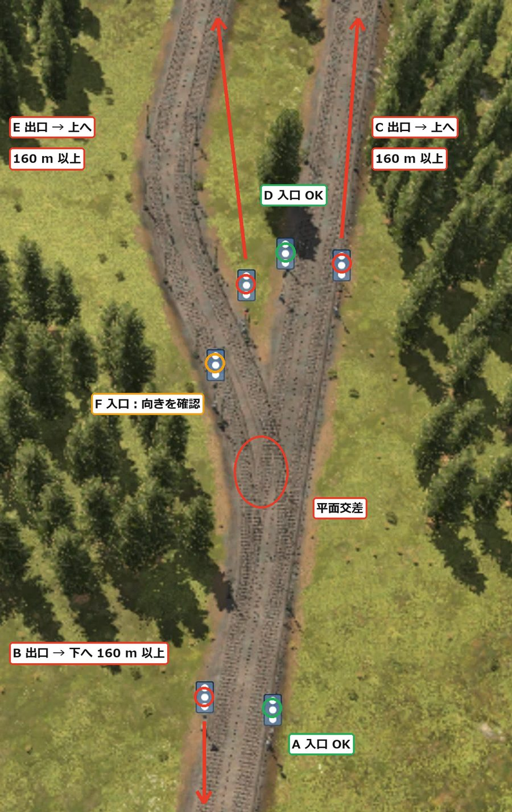
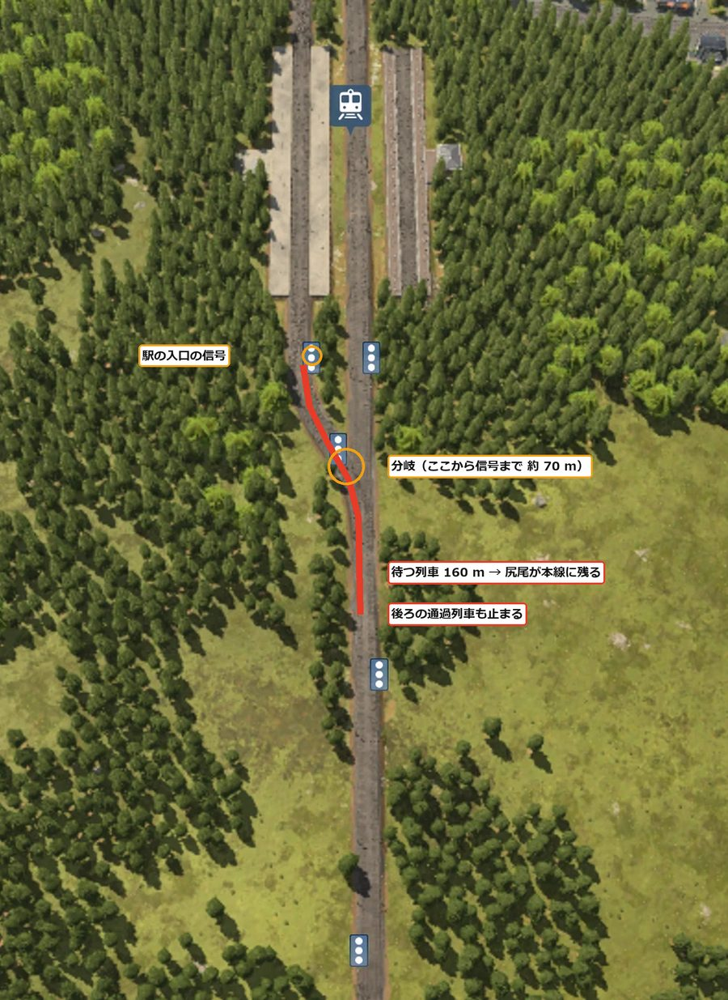
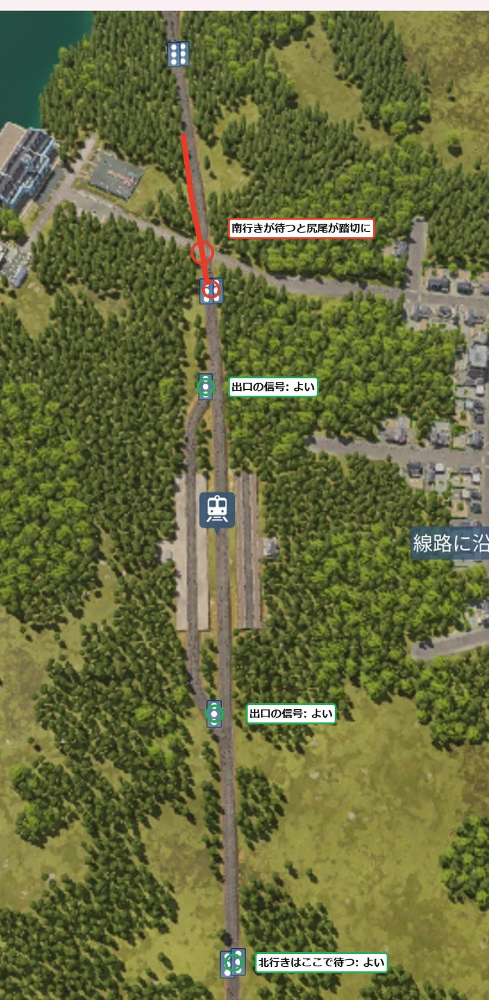

[日本語](../tottori.html) · **English** · [Deutsch](../de/tottori.html) · [中文](../zh/tottori.html) · [한국어](../ko/tottori.html)

This is a record of linking five towns around a big lake in the subarctic climate by train.
I started in 1960. The main goal this time is to learn how to build stations and signals so that the problem that hurt me most last time, "long trains clog the track", does not happen.

## Contents
- [World settings](#settings)
- [Day 1 — Rethinking the station and signal pattern](#day1)

## World settings

| Item | Setting |
|---|---|
| Climate | Subarctic |
| Map | Medium (8 × 16 km). A big lake in the middle |
| Towns and industries | Sparse (5 towns, 12 industries) |
| Difficulty | Easy (vehicles, construction and upkeep at half price). Town rating sensitivity off |
| Start | 1960 |
| Goals | Tycoon in a 3rd climate, operation that doesn't clog trains, commuting and transfers by train |

All five towns stand in one row along the west to south shore of the lake, from northwest to southeast.
Most of the industries are on the east side of the lake. In the southwest there are mountains 200–298 m high.

## Day 1 — Rethinking the station and signal pattern (1960–1961)

### Decide the train length first

What hurt me most in the last world, Yachiyo, was clogging by long trains.
I was putting trains of about 205 m into 160 m platforms, and the tails sticking out blocked a junction, so a key industry stopped.

At first I planned to build with "240 m platforms and signal spacing of 300 m or more".
But that needs a lot of flat land. On this map, with many mountains and lakes, it isn't realistic.

So I decided to fix the train length to be shorter instead.

- Trains fit a 160 m platform on every line (a locomotive of about 3,000 kW plus 10–11 cars, carrying about 150 a year)
- Plan 400 m of land per station (160 m of platform plus 110 m of junction at each end)
- To make up the difference, add more trains instead of making them longer
- For passengers too, run short trains more often to raise the frequency

### Signals at a junction

From the double-track main line, I branched the track to a station to the left (right-hand traffic).
The signal before the junction is placed correctly if it sits right before the junction.
What to watch is the signal after the junction. If it sits right after the junction, the tail of a train stopped there stays on the junction.
While it does, trains in the opposite direction can't pass the junction either. Place the signal after the junction at least the train length (160 m) away.

{: width="420"}

### Do we need long straights before and after a station?

I had been allowing long straights before and after stations, but I want to build more compactly.
Thinking about it, length is needed only "when the tail of a train waiting at a signal reaches a junction that other trains use".
The waiting spot can be curved or on a slope.

The junctions at the two ends of a station (a 40 m double crossover plus a 70 m merge) lie beyond the entrance signal.
So they don't count toward the length of the waiting spot.

At Hadano station I moved the junction close to the platform.
Then there were only about 70 m from the signal before the platform to the junction.
When there is a train at the platform, the next train waits at this signal. The tail of the 160 m train stays past the junction on the main line, and even the through train behind it is stopped.

{: width="420"}

### No signal at the entrance

Hadano station is a 2-platform, 2-track station to begin with, so if a train enters the free platform there is no waiting train.
So I changed how the signals are placed.

- Before: a signal in front of each double crossover junction at both ends of the station
- Now: a signal only right before the exit junction, on the side where trains leave in right-hand traffic. None at the entrance (staggered)

A train entering the station waits at the signal of the block before it. There its tail doesn't reach the station's junction.
When it proceeds, it picks the free platform and enters.
A train leaving the station waits stopped inside the platform at the exit signal, so it doesn't block the main line.

{: width="420"}

In just one place, when a southbound train waits at the north signal, its tail reaches a road's level crossing.
Cars can't pass meanwhile, but I decided to make it a grade-separated crossing only once it becomes a problem.

> **What I learned**
> - Decide the train length first, and the platform and land lengths follow. Adding trains takes less land than lengthening them
> - Keep the signal after a junction at least the train length away. If the tail of a stopped train stays on the junction, the opposite direction stops too
> - Length is needed only when the tail of a waiting train reaches a junction other trains use. The waiting spot can be curved or on a slope
> - For an intermediate station with 2 platforms and 2 tracks, putting no signal at the entrance and one only right before the exit makes it shorter. Check that there is no junction or level crossing behind the signal before it
> - I think of signals as freeing a section as soon as a train has passed it, so other trains can go through (not yet confirmed)
