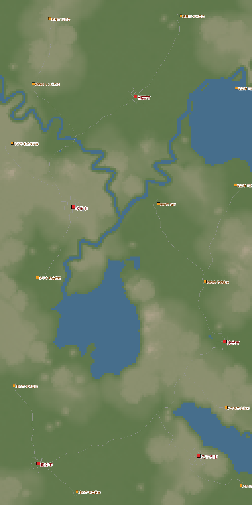
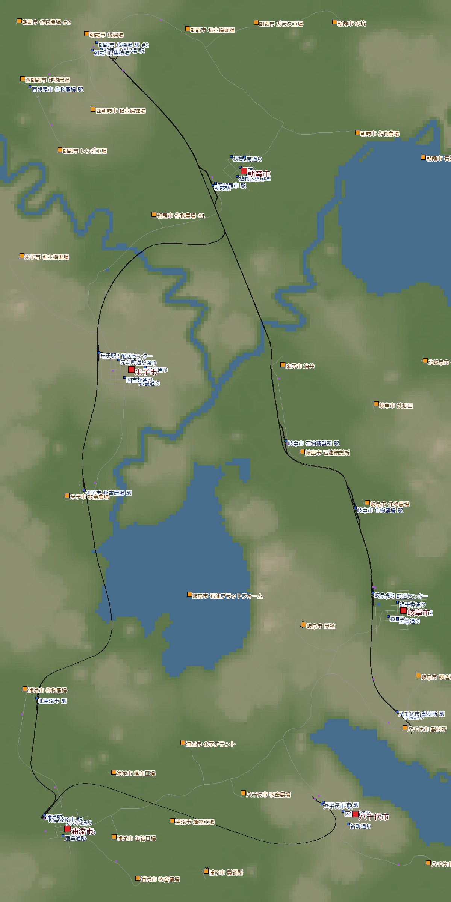
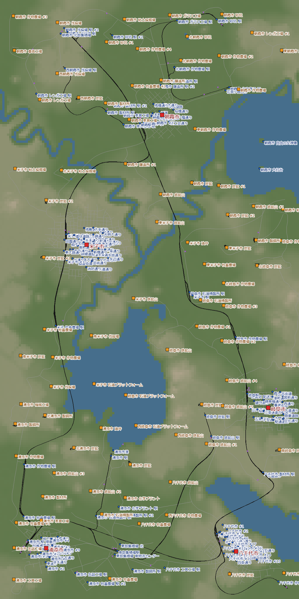

[日本語](../yachiyo.html) · **English** · [Deutsch](../de/yachiyo.html) · [中文](../zh/yachiyo.html) · [한국어](../ko/yachiyo.html)

This is the story of linking five towns, scattered across a plateau and lowlands in the dry climate, with one logs trunk line and collection warehouses.
I started in 1950, restarted once, and reached the company's top rank, Tycoon, in 1985. It took 4 real days.

## Contents
- [World settings](#settings)
- [Day 1 — In the red, so I start over](#day1)
- [Day 2 — The logs trunk line and collection warehouses](#day2)
- [Day 3 — Removing what holds each town back](#day3)
- [Day 4 — Leaving it running, and Tycoon](#day4)
- [Looking back](#retro)

## World settings

| Item | Setting |
|---|---|
| Climate | Dry |
| Map | Medium (8 × 16 km). Lakes, rivers and mountains on normal |
| Towns and industries | Sparse (5 towns, 13 industries) |
| Difficulty | Easy (vehicles, construction and upkeep at half price) |
| Start | 1950 |
| Goals | Play the dry climate I hadn't tried yet, and reach Tycoon (population 19,415) |

The dry climate has no Cement Plant, Fishing Grounds, Paper Mill or Tire Factory, among others.
The terrain has two levels: a plateau about 165 m high and lowlands about 14 m high.
Yonago and Yachiyo sit on the plateau; the other three towns are in the lowlands.

{: width="420"}

## Day 1 — In the red, so I start over (1950–1951)

With my starting money I ran a freight train for Clay → Bricks and a passenger train between Asaka and Yonago.
I electrified the passenger line too.

Two years later my account stood at −$2.1M.
I had taken all four Loans, and repayments were about $0.78M a month (about $9.4M a year).
One train earned $2.4–3.6M a year, nowhere near enough.

I also tried Subsidies.
The advance payment seemed to bring my account back to +$15M,
but I had accepted them without any line to carry the Workers, so both failed.
The penalties pushed my account to −$19.8M.

At this point I decided to start over from 1950 with the same seed.

> **What I learned**
> - First, compare loan repayments with what one train earns. Passengers and electrification come after you are making money
> - A subsidy's advance payment is not income. Accept one only once a line that meets its conditions is running
> - Take loans one at a time, starting with "Medium", which has light monthly repayments

## Day 2 — The logs trunk line and collection warehouses (1950–1955)

On the restart, I worked hard to push a logs line from the Logging Camp in the north to the Saw Mill in the southeast.
I made this the **trunk line**, and gathered each area's industries at **collection warehouses** before loading their cargo onto the trunk line.
I built it as cheaply as I could: Simple Tracks, no electrification.

The height difference between the plateau and the lowlands is large, and bridging the valley between Yachiyo and Gifu was very expensive.
Still, this was Easy, so placing things a little sloppily hardly hurt my progress.

By 1955 I had $262M in the account, no loans, and 27 lines.
The top earners were the Logs + Vegetables train (+$9.0M a year) and the Asa-Yone passenger line (Asaka–Yonago, +$6.2M a year).

{: width="420"}

> **What I learned**
> - Build one long trunk line first, and the network grows just by hanging collection warehouses off it
> - This was enough to produce and deliver Vegetables, Planks, Fuel, Meat and Bricks

## Day 3 — Removing what holds each town back (1966–1967)

In 1966: population 10,551, account $2.02B.
Population growth was about 2.8 times what it had been in 1955.

A town stops growing at its lowest rating. Going town by town, each one was held back by something different.

| Town | Rating holding growth back | What I did |
|---|---|---|
| Gifu | Traffic (private cars flooding the main street in the town center) | Split the tram into two lines and ran one through the western half too |
| Gifu, Yachiyo | Urban care | Restored the broken Main Connection between Gifu and Yachiyo |
| Yachiyo | Traffic | A passenger tram in the southern half |
| Asaka | Pollution | Decided to put every Landmark here (but there was no Stone) |

Gifu's traffic rating went from 0.42 to 0.74, and public transport usage from 0.09 to 0.26.
Growth reached about 635 people per hour, the fastest in this world.

Every Landmark except the Ship Museum needs Stone.
This map had not a single Quarry, so I couldn't build them.

> **What I learned**
> - Traffic means private cars. Don't cut trucks; raise public transport usage with passenger lines
> - If urban care suddenly drops, check whether a Main Connection between towns has been cut

## Day 4 — Leaving it running, and Tycoon (1968–1985)

From 1969 on, I mostly left the game running.
From the year I brought a new freight line into Yonago, Yonago's noise and traffic got worse, and growth fell to about 230 people per hour.
Even so, by 1985 the population was 19,233. Only 182 to go.

Then the population hit 19,415. I became a Tycoon.
After the tropics in 08, this was my Tycoon in a second climate.

{: width="420"}

But while I left it running, trouble had been building.
Long trains were jamming just before stations, the main producing industries stopped, and many of them closed.
Between 1967 and 1985, 29 industries disappeared and 27 new ones appeared.
I had made 160 m my standard platform length, but an 8-car Shinkansen 0 Series was over 200 m long.

> **What I learned**
> - Run a train longer than the platform and its tail sits on the switch, stopping the trains behind it. The industries at the far end then close
> - The remaining growth bottleneck is in-town delivery. Even with transport between towns in place, if there aren't enough lines delivering from the warehouse into the town, cargo piles up in the warehouse

## Looking back

### What was fun
- Hanging collection warehouses off the logs trunk line made the network grow neatly
- I struggled with the height difference between plateau and lowlands, and bridged the valley to connect them
- On Easy, I could play without worrying too much about placement

### What I'll carry forward
- First compare repayments with earnings, and lay the money-making freight lines first
- Accept subsidies only once a line that meets the conditions is running
- Once the trunk line and collection warehouses are in place, sort out in-town delivery first
- Decide the longest train for each line up front: 240 m platforms, and at least 300 m for signal spacing and the waiting space before stations

Next up: the subarctic climate. With town rating sensitivity turned off, a setting where population grows very fast, I'll learn to run trains of around 200 m.
I'll also go for Centralized (all 10 Landmarks) and Summit Stopover (a station more than 500 m high).
