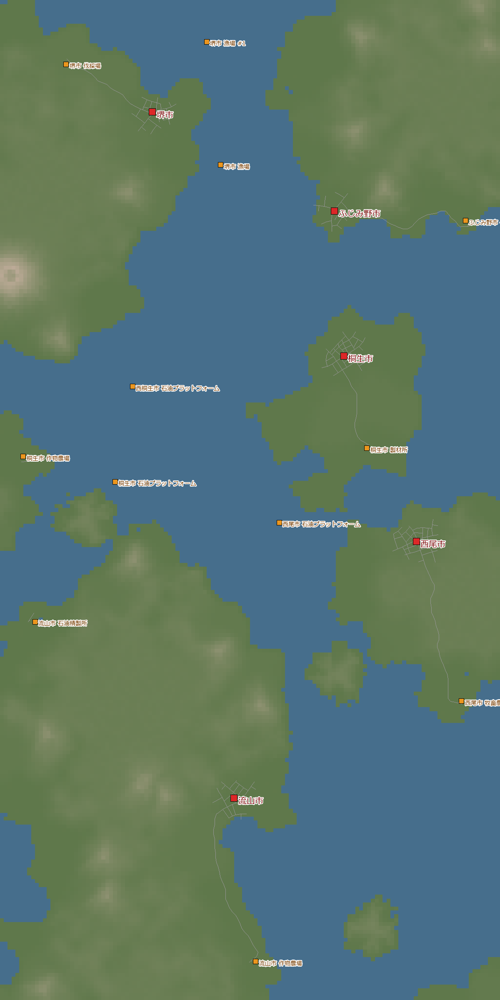
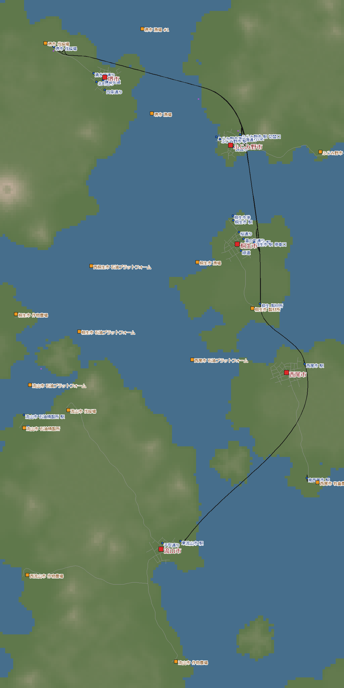
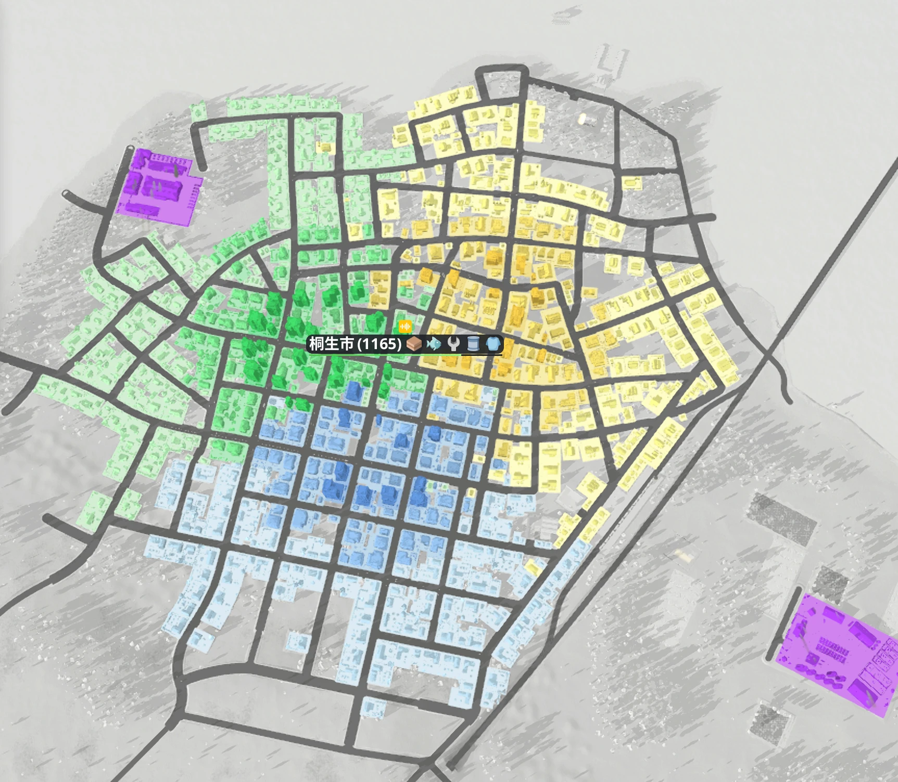
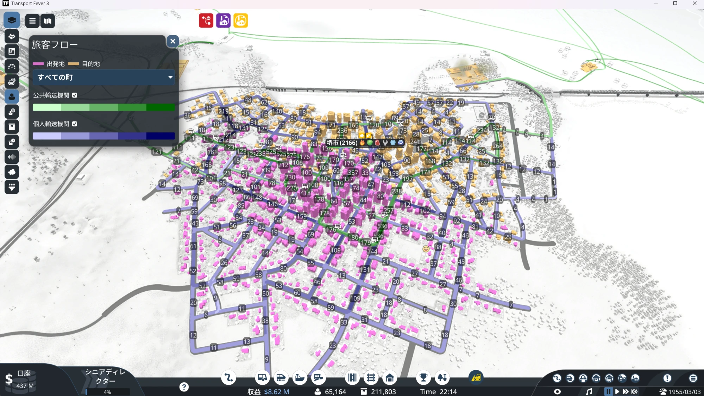
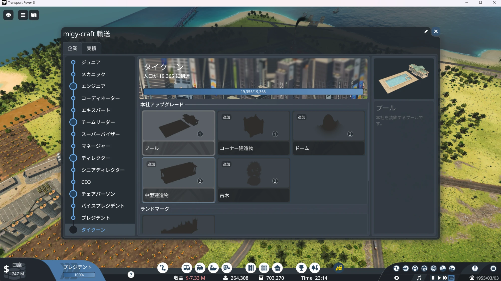
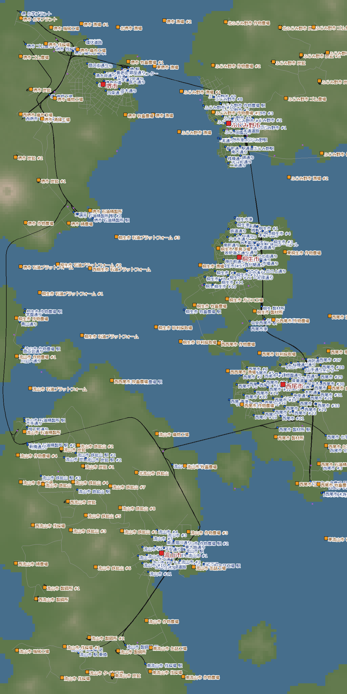

[日本語](../nagareyama.html) · [English](../en/nagareyama.html) · [Deutsch](../de/nagareyama.html) · [中文](../zh/nagareyama.html) · **한국어**

열대 다도해에서 5개 섬의 도시를 간선 철도 한 줄로 이어 간 기록이에요.
1930년에 시작해서 1955년에 달력을 멈추고, 회사 최고 등급인 '타이쿤'까지 즐겼어요.

## 목차
- [월드 설정](#settings)
- [1일차 — 섬을 잇는 선로 한 줄](#day1)
- [2일차 — 석유 굴착 플랫폼과 배](#day2)
- [3일차 — 달력을 멈추다](#day3)
- [4일차 — 특전으로 공해를 줄이다](#day4)
- [5일차 — 정체와 교통 혼잡, 그리고 타이쿤](#day5)
- [6일차 — 놓친 업적 줍기](#day6)
- [돌아보기](#retro)

## 월드 설정

| 항목 | 설정 |
|---|---|
| 기후 | 열대 |
| 맵 | 중간 (8 × 16 km). 도시 5개가 모두 다른 섬 |
| 도시·산업 | 드문드문 (도시 5·산업 12) |
| 난이도 | 노멀 상당 (커스텀) |
| 시작 | 1930년 |
| 목적 | 아직 안 해 본 열대에서 플레이 (업적 세계 여행자)·타이쿤 |

열대에는 여기에만 있는 산업이 있어요.
고무나무 농장 → 타이어 공장 → 운송 수단 공장으로 이어지는 흐름이에요.
반대로 음료·책·시멘트·점토·종이 등은 나오지 않아요.
원유는 육지의 유정이 아니라 바다 위의 **석유 굴착 플랫폼**에서 나와요.

{: width="420"}

## 1일차 — 섬을 잇는 선로 한 줄 (1930~1933)

처음 돈벌이는 통나무예요.
벌채용 캠프 → 제재소 → 기류 → 후지미노로 달리는 열차를 2편 냈어요.
증기 기관차에 기둥식 화차 10량 편성으로, 연 +$7.9M이에요.

나란히 낚시터에서 후지미노 항구로 가는 배도 2척 띄웠어요.
어류를 나르는 보조금이 2개 나와 있었는데, 둘 다 달성했어요.

1933년에는 도시 간 선로 한 줄이 완성됐어요.
사카이 섬 → 후지미노 → 기류 → 니시오 → 나가레야마로, 5개 섬을 남북으로 꿰뚫는 간선이에요.

{: width="420"}

> **알게 된 것**
> - 도시 배치가 남북으로 곧게 놓여 있으면 간선을 한 줄 차분하게 만들 수 있다. "나중에 고치자"를 전제로 한 선로를 안 만들어도 됐다
> - 새 노선은 처음부터 복선으로 하고, 신호는 깐 날에 전부 '일방통행'으로 해 둔다

## 2일차 — 석유 굴착 플랫폼과 배 (1934~1942)

널빤지·어류·채소·연료 등 도시가 원하는 것을 차례로 날랐어요.

연료의 원료인 원유는 바다 위 석유 굴착 플랫폼에서 나와요.
배로 정유소까지 나르고, 정유소에서 니시오로도 배 7척으로 연료를 보냈어요.
석유 굴착 플랫폼에 헬리콥터를 착륙시켜서 업적 바다로도 땄어요.

채소는 트럭 12대와 열차 2편이에요.
도중에 사카이 섬에 새 정유소가 생겨서, 사카이의 연료는 거기서 나오도록 바꿨어요.

> **알게 된 것**
> - 배는 '선로를 못 놓는 바다를 건너는 곳'에만 쓰는 편이 좋다. 큰 항구를 처음부터 만들기는 번거롭고, 대량·느린 수송은 별로 살지 못했다

## 3일차 — 달력을 멈추다 (1955)

1955년에서 달력(게임 내 날짜의 흐름)을 멈췄어요.
해는 그대로인 채 도시와 수송만 계속 움직여요.
그 시대의 증기 기관차와 디젤을 서두르지 않고 느긋하게 즐길 수 있어서 좋았어요.

후지미노에서는 널빤지와 어류를 전차로 도시 안에 나눠 줬어요.
그런데 널빤지가 생각만큼 안 닿아요.
알아보니 정류장 범위 안에 들어 있던 창고가 널빤지를 전부 받고 있었어요.
창고를 범위에서 빼자 널빤지 공급이 44% → 82%로 올랐어요.

> **알게 된 것**
> - 정류장 범위에 창고가 있으면, 전하려던 화물을 창고가 먼저 가져가 버린다

## 4일차 — 특전으로 공해를 줄이다 (1955)

도시가 더 자라지 않게 돼서, 도시마다 '성장을 막고 있는 평가'를 살펴봤어요.
많은 도시에서 가공 공장의 공해가 발목을 잡고 있었어요.

회사 등급이 오르면 받는 특전으로 공해를 줄여 봤어요.
- **산업 녹화**: 산업 하나의 공해를 −80%. 기류의 가구 공장과 나가레야마의 통조림 공장에 썼어요
- **오염 제거 시설**: 건설 $220M, 1기당 유지비 $10M. 사카이에 지었지만 사카이의 공해는 31% → 33%로 거의 그대로여서 철거했어요

> **알게 된 것**
> - 특전은 가격과 효과 범위를 확인하고 쓴다. 녹화(−80%)가 훨씬 싸고 확실하다

## 5일차 — 정체와 교통 혼잡, 그리고 타이쿤 (1955)

방침을 '초기 화물을 전부 갖춘 뒤에 가공'에서 '가공을 먼저'로 바꿨어요.
여객 열차 '사카이 - 후지미노'도 시작했어요. 역 5곳을 오가는 열차로, 연 +$17.9M 흑자예요.

하룻밤 방치했더니 인구는 9,648 → 16,244명, 계좌는 $331M → $1,079M으로 늘어 있었어요.

### 철도 정체

기세를 타고 열차를 17량에서 23량으로 단숨에 늘렸어요.
그러자 오후에 2시간 가까이 철도 대부분이 역에 도착하지 못했어요.
계좌는 $1,057M → $672M. 약 $385M이 사라졌어요.
회차가 많은 역(사카이 6개 노선·나가레야마 5개 노선)에서 막힌 것 같아요.
여객 열차를 2편 팔고서야 겨우 움직이기 시작했어요.

### 기류의 교통 혼잡

이번에는 도시 안이 막혀서 트럭이 달리지 못하게 됐어요.
기류의 교통 평가는 29%까지 떨어져 있었어요.

원인은 섬과 섬을 잇는 도로를 만든 것이었어요.
옆 도시로 가는 사람들이 차로 가려고 도시 안에 넘쳐 났던 거예요.
도로를 끊어서, 도시와 도시 사이는 열차로만 오갈 수 있게 했어요.

| 기류 | 도로를 끊기 전 | 끊은 후 |
|---|---|---|
| 교통 평가 | 29% | 96% |
| 대중교통 이용률 | 28% | 56% |
| 도시 성장 단계 | 1 | 2 |

### 타이쿤

회사 등급은 세계 인구로 올라요.
이 월드의 타이쿤은 '인구 19,365명'.
23시 14분, 드디어 닿았어요. 업적 출세 가도예요.

> **알게 된 것**
> - 열차는 한 편씩 더하고, 더할 때마다 상황을 본다. 한꺼번에 늘리면 회차하는 역에서 막힌다
> - 도시와 도시를 도로로 이으면, 옆 도시로 가는 자가용 때문에 도시 안이 막힌다. 도시 사이는 열차나 배로 잇고, 도시 간 도로는 끊어 버리는 편이 좋다
> - 타이쿤에 필요한 인구는 월드마다 다르다 (처음 인구로 정해진다). 첫날에 회사 창에서 목표를 봐 둔다

## 6일차 — 놓친 업적 줍기

타이쿤 이후에는 업적을 주웠어요.

- **승객의 개척자** (승객 합계 100만 명): 지금까지의 월드 합계로 달성. 월드를 넘어서 세어 줘요
- **마스터 판매원** (어느 기후에서나 나오는 화물을 전 종류 배달): 남은 건 열대에만 있는 타이어와 운송 수단 2가지였어요. 고무 → 타이어 공장 → 운송 수단 공장으로 나르고, 운송 수단을 도시에 배달해서 달성

{: width="420"}

## 돌아보기

### 즐거웠던 것
- '섬과 섬을 잇는다'는 목표가 알기 쉬웠다
- 도시 배치가 좋아서 간선 한 줄을 차분하게 만들 수 있었다
- 달력을 멈추고 그 시대의 기관차를 느긋하게 즐길 수 있었다
- 숫자를 적어 가며 도시마다 무엇이 부족한지 보면서 놀 수 있었다

### 다음에 살릴 것
- 도시와 도시는 도로로 잇지 않는다 (도시 간 도로는 끊는다)
- 열차는 한 편씩 더한다
- 첫날에 타이쿤에 필요한 인구를 봐 둔다
- 도시가 2차 가공품을 원하면, 1차 산품을 시내 배송보다 가공 시설로 돌리는 쪽을 우선한다 (시내 배송을 늘리고 싶어지긴 하지만)

다음은 건조 기후를 이지 난이도로. 아직 못 본 동물(쿠거·독수리)도 찾아볼 거예요.
