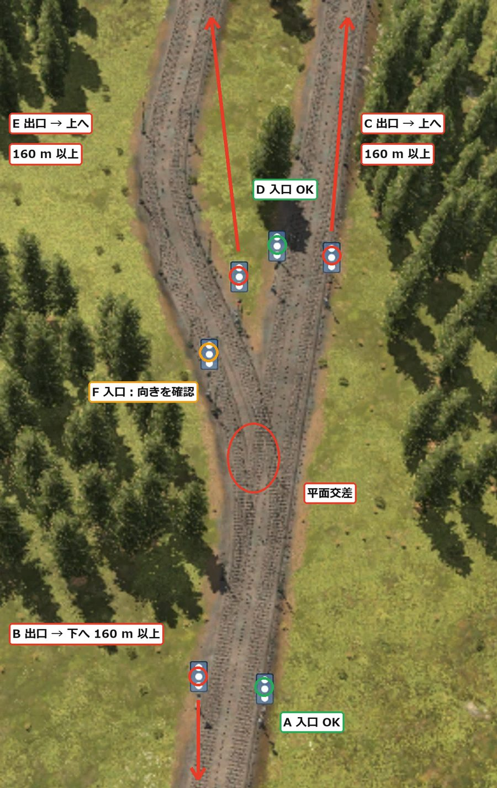
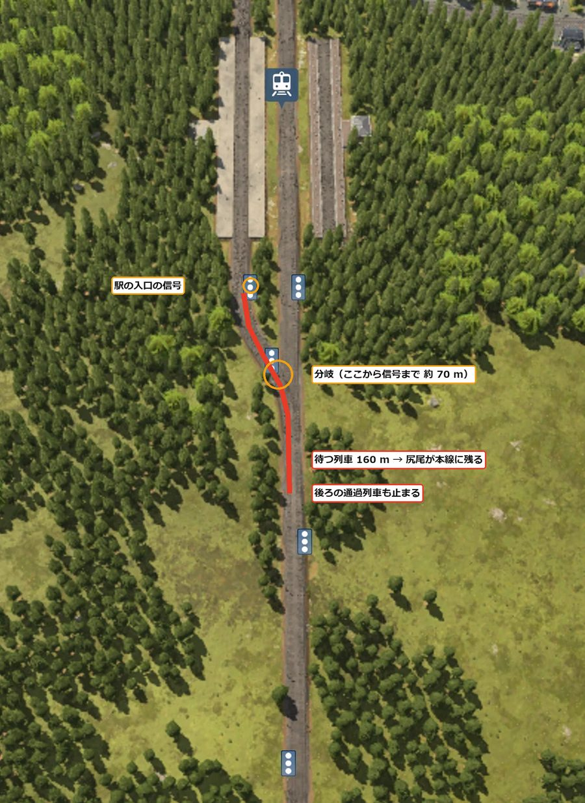
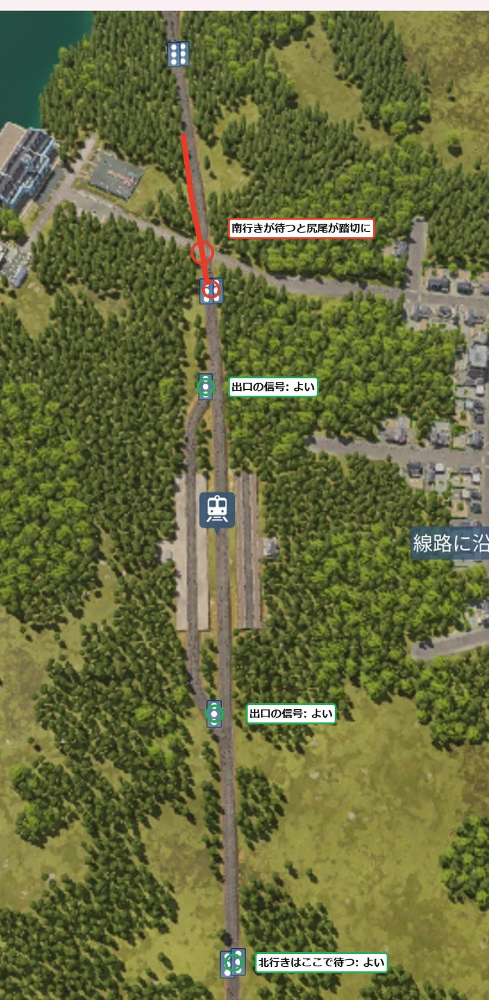

[日本語](../tottori.html) · [English](../en/tottori.html) · [Deutsch](../de/tottori.html) · [中文](../zh/tottori.html) · **한국어**

아북극의 큰 호수 주변에 늘어선 5개 도시를 열차로 이어 가는 기록이에요.
1960년에 시작했어요. 이번의 가장 큰 목표는, 지난번에 가장 곤란했던 '긴 편성 때문에 선로가 막히는' 일이 생기지 않는 정류장과 신호기 구성법을 익히는 거예요.

## 목차
- [월드 설정](#settings)
- [1일차 — 정류장과 신호기의 형태를 다시 생각하다](#day1)

## 월드 설정

| 항목 | 설정 |
|---|---|
| 기후 | 아북극 |
| 맵 | 중간 (8 × 16 km). 한가운데에 큰 호수 |
| 도시·산업 | 드문드문 (도시 5·산업 12) |
| 난이도 | 쉬움 (운송 수단·건설·유지비가 절반). 도시 평가의 민감도는 끔 |
| 시작 | 1960년 |
| 목적 | 세 번째 기후에서 타이쿤·열차가 막히지 않는 운영·열차로 통근과 환승 |

도시 5개는 모두 호수의 서쪽에서 남쪽 기슭에, 북서에서 남동으로 한 줄로 늘어서 있어요.
산업은 대부분 호수의 동쪽에 있어요. 남서쪽에는 높이 200~298 m의 산지가 있어요.

## 1일차 — 정류장과 신호기의 형태를 다시 생각하다 (1960~1961)

### 편성의 길이를 먼저 정한다

지난번 야치요에서 가장 곤란했던 것은 긴 편성 때문에 막히는 일이었어요.
160 m 승강장에 약 205 m 편성을 넣었더니, 삐져나온 꼬리가 분기를 막아 주요 산업이 멈췄어요.

처음에는 '승강장 240 m·신호기 간격 300 m 이상'으로 짓는 안을 세웠어요.
하지만 그러면 평평한 땅이 많이 필요해요. 산과 호수가 많은 이 맵에서는 무리예요.

그래서 편성 쪽을 짧게 고정하기로 했어요.

- 편성은 전 노선 160 m 승강장에 들어가는 길이 (약 3,000 kW 기관차 + 10~11량으로, 1년에 약 150을 나른다)
- 정류장 용지는 400 m (승강장 160 m + 양 끝의 분기에 110 m씩)를 잡아 둔다
- 부족한 만큼은 편성을 늘리지 않고 운행 횟수로 늘린다
- 여객도 짧은 편성을 여러 번 달리게 해서 빈도를 높인다

### 분기의 신호기

복선 간선에서 정류장으로 향하는 선로를 왼쪽으로 분기시켰어요 (우측통행).
분기 앞의 신호기는 분기 바로 앞에 두면 올바른 위치예요.
조심할 것은 분기 뒤의 신호기예요. 분기를 지나자마자 두면, 거기서 멈춘 열차의 꼬리가 분기 위에 남아요.
그동안은 반대 방향 열차도 분기를 지나갈 수 없어요. 분기 뒤의 신호기는 편성의 길이(160 m) 이상 떨어뜨려 둬요.

{: width="420"}

### 정류장 앞뒤에 긴 직선이 필요할까

정류장 앞뒤에 긴 직선을 잡아 뒀는데, 더 콤팩트하게 만들고 싶어요.
생각해 보니 길이가 필요한 것은 '신호기 앞에서 기다리는 열차의 꼬리가 다른 열차가 지나가는 분기에 걸릴 때'뿐이었어요.
기다리는 곳은 굽어 있어도, 언덕이어도 괜찮아요.

정류장 양 끝의 분기(양쪽 건넘선 40 m + 합류 70 m)는 입구 신호기보다 앞에 있어요.
그래서 기다리는 곳의 길이로 셀 수 없어요.

하타노 정류장에서 분기를 승강장 바로 가까이까지 붙여 봤어요.
그랬더니 승강장 앞 신호기에서 분기까지가 약 70 m밖에 안 돼요.
승강장에 앞 열차가 있으면 다음 열차는 이 신호기에서 기다려요. 160 m 편성의 꼬리가 분기를 넘어 본선에 남아서, 뒤의 통과 열차까지 멈춰 버려요.

{: width="420"}

### 입구에 신호기를 두지 않는다

하타노 정류장은 원래 승강장 2개 · 선로 2개라서, 비어 있는 쪽 승강장에 넣으면 기다리는 열차가 생기지 않아요.
그래서 신호기를 두는 방식을 바꿨어요.

- 지금까지: 정류장 양 끝의 건넘선 분기 앞에 각각 신호기를 뒀다
- 이번: 우측통행에서 정류장을 나가는 쪽, 출구 분기 바로 앞에만 신호기를 둔다. 입구에는 두지 않는다 (엇갈리게)

정류장에 들어오는 열차는 한 구간 앞 폐색의 신호기에서 기다려요. 거기라면 꼬리가 정류장 분기에 걸리지 않아요.
진행할 때는 비어 있는 쪽 승강장을 골라 들어가요.
정류장을 나가는 열차는 출구 신호기에서 승강장 안에 멈춰 기다리니까 본선을 막지 않아요.

{: width="420"}

딱 한 곳, 북쪽 신호기에서 남행이 기다리면 꼬리가 도로 건널목에 걸려요.
그동안은 차가 지나갈 수 없지만, 문제가 되면 그때 입체 교차로 바꾸기로 했어요.

> **알게 된 것**
> - 편성의 길이를 먼저 정하면 승강장과 용지의 길이가 정해진다. 길게 하는 것보다 운행 횟수로 늘리는 쪽이 땅이 덜 든다
> - 분기 뒤의 신호기는 편성의 길이 이상 떨어뜨린다. 멈춘 열차의 꼬리가 분기에 남으면 반대 방향도 멈춘다
> - 길이가 필요한 것은 기다리는 열차의 꼬리가 다른 열차가 지나가는 분기에 걸릴 때뿐이다. 기다리는 곳은 곡선이어도 언덕이어도 된다
> - 승강장 2개 · 선로 2개의 중간 정류장은 입구에 신호기를 두지 않고 출구 바로 앞에만 두면 짧게 만들 수 있다. 앞쪽 신호기 뒤에 분기와 건널목이 없는지는 봐 둔다
> - 신호기는 열차가 지나간 구간을 곧바로 비워서 다른 열차를 지나가게 하는 움직임이라고 보고 생각하고 있다 (아직 확인하지 못했다)
