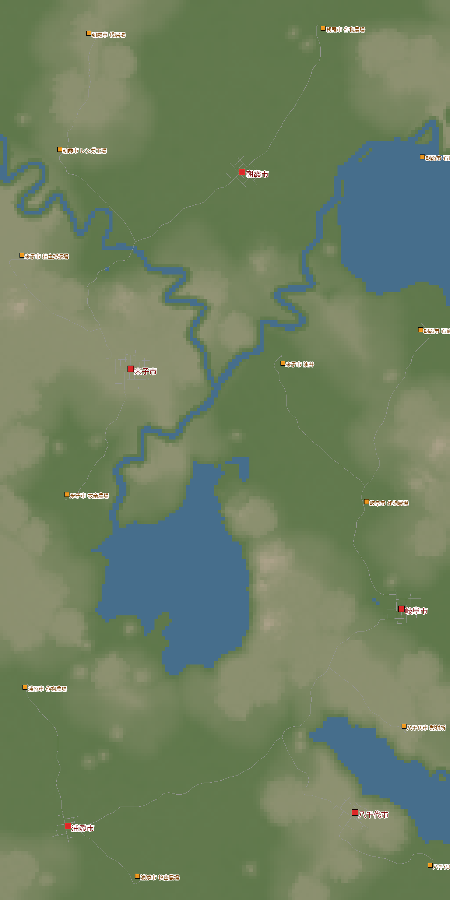
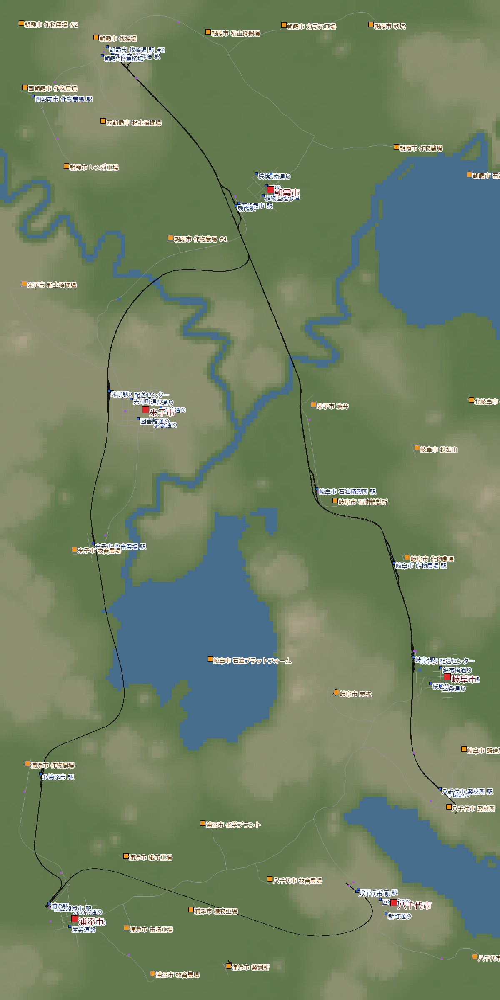
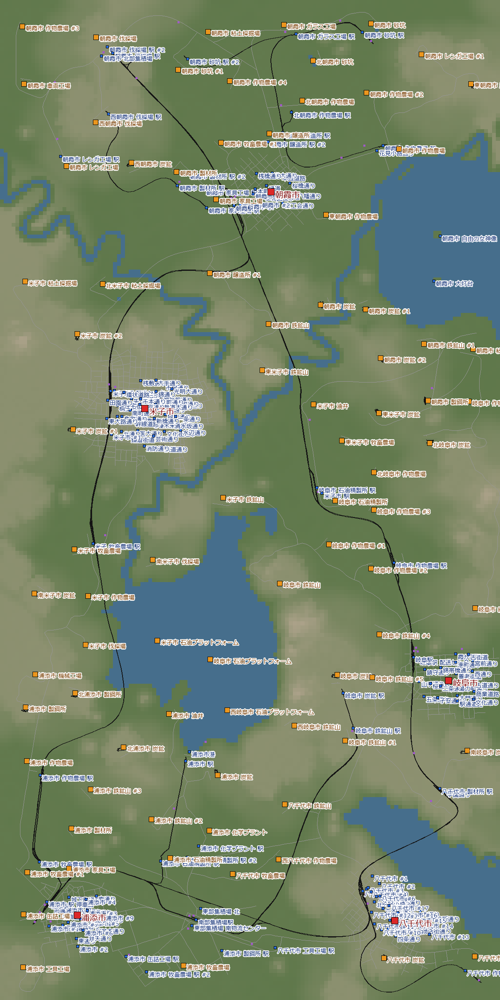

[日本語](../yachiyo.html) · [English](../en/yachiyo.html) · [Deutsch](../de/yachiyo.html) · [中文](../zh/yachiyo.html) · **한국어**

건조 기후의 고지대와 저지대에 흩어진 5개 도시를, 통나무 간선 한 줄과 집하장으로 이어 간 기록이에요.
1950년에 시작해서 한 번 다시 하고, 1985년에 회사 최고 등급인 '타이쿤'에 닿았어요. 실시간으로 4일이에요.

## 목차
- [월드 설정](#settings)
- [1일차 — 계좌가 마이너스가 되어 다시 하다](#day1)
- [2일차 — 통나무 간선과 집하장](#day2)
- [3일차 — 도시마다 성장을 막는 것을 걷어 내다](#day3)
- [4일차 — 방치해서 타이쿤](#day4)
- [돌아보기](#retro)

## 월드 설정

| 항목 | 설정 |
|---|---|
| 기후 | 건조 |
| 맵 | 중간 (8 × 16 km). 호수·강·산 보통 |
| 도시·산업 | 드문드문 (도시 5·산업 13) |
| 난이도 | 쉬움 (운송 수단·건설·유지비가 절반) |
| 시작 | 1950년 |
| 목적 | 아직 안 해 본 건조 기후에서 플레이·타이쿤 (인구 19,415) |

건조 기후에는 시멘트 공장·낚시터·제지 공장·타이어 공장 등이 없어요.
지형은 높이 약 165 m의 고지대와 약 14 m의 저지대, 2단이에요.
요나고와 야치요는 고지대 위, 나머지 도시 3개는 저지대에 있어요.

{: width="420"}

## 1일차 — 계좌가 마이너스가 되어 다시 하다 (1950~1951)

처음 자금으로 찰흙 → 벽돌 화물 열차와, 아사카 - 요나고 여객 열차를 달렸어요.
여객 노선은 전철화도 했어요.

2년이 지나자 계좌는 −$2.1M.
대출을 4개 다 받아서 상환이 매달 약 $0.78M (연 약 $9.4M)이에요.
열차 한 편의 벌이는 연 $2.4~3.6M이라 도저히 따라잡지 못해요.

보조금에도 손을 댔어요.
선지급으로 계좌가 +$15M으로 돌아온 것처럼 보였지만,
노동자를 나르는 노선이 없는 채로 받았기 때문에 2건 모두 실패.
벌금으로 계좌는 −$19.8M이 됐어요.

그래서 같은 시드로 1950년부터 다시 하기로 했어요.

> **알게 된 것**
> - 처음에 대출 상환과 열차 한 편의 벌이를 비교한다. 여객과 전철화는 돈을 번 다음에
> - 보조금 선지급은 벌이가 아니다. 조건을 채우는 노선이 움직인 다음에 받는다
> - 대출은 매달 상환이 가벼운 '중간'부터 하나씩 받는다

## 2일차 — 통나무 간선과 집하장 (1950~1955)

다시 하면서, 북쪽 벌채용 캠프에서 남동쪽 제재소까지 통나무 노선을 애써 뚫었어요.
이걸 **간선**으로 삼고, 지역마다 산업을 **집하장**에 모은 뒤 간선에 실어요.
간이 선로·비전철화로 되도록 싸게 깔았어요.

고지대와 저지대의 높이 차가 커서, 야치요와 기후 사이 골짜기에 다리를 놓는 데 돈이 아주 많이 들었어요.
그래도 쉬움 난이도라서 설비를 조금 대충 놓아도 공략에는 별로 지장이 없어요.

1955년에는 계좌 $262M·대출 0. 노선은 27개가 됐어요.
돈벌이 주력은 통나무+채소 열차 (연 +$9.0M)와 여객 아사요선 (아사카 - 요나고, 연 +$6.2M)이에요.

{: width="420"}

> **알게 된 것**
> - 긴 간선을 한 줄 먼저 뚫어 두면, 집하장을 매달기만 해도 망이 넓어진다
> - 채소·널빤지·연료·고기·벽돌은 이 방법으로 충분히 만들고 나를 수 있었다

## 3일차 — 도시마다 성장을 막는 것을 걷어 내다 (1966~1967)

1966년, 인구 10,551명·계좌 $2.02B.
인구 증가 속도는 1955년의 약 2.8배가 돼 있었어요.

도시는 가장 낮은 평가에서 성장이 멈춰요. 도시마다 살펴보니 막고 있는 것이 제각각이었어요.

| 도시 | 성장을 막던 평가 | 둔 수 |
|---|---|---|
| 기후 | 교통 (자가용이 도시 한가운데 길에 넘쳐 남) | 전차를 2개로 나눠서 서쪽 절반에도 다니게 함 |
| 기후·야치요 | 도시 관리 | 끊겨 있던 기후 - 야치요의 주 연결부를 되살림 |
| 야치요 | 교통 | 남쪽 절반에 여객 전차 |
| 아사카 | 공해 | 랜드마크를 전부 여기에 짓기로 함 (그런데 석재가 없었다) |

기후의 교통 평가는 0.42 → 0.74, 대중교통 이용률은 0.09 → 0.26으로 올랐어요.
성장은 1시간에 약 635명이 되어, 이 월드에서 가장 빨랐어요.

랜드마크는 선박 박물관 말고는 전부 '석재'가 필요해요.
이 맵에는 채석장이 하나도 없어서 짓지 못했어요.

> **알게 된 것**
> - 교통 혼잡은 자가용 때문이다. 트럭을 줄이는 게 아니라, 여객 노선으로 대중교통 이용률을 올린다
> - 도시 관리가 갑자기 떨어지면, 도시와 도시 사이의 주 연결부가 끊기지 않았는지 본다

## 4일차 — 방치해서 타이쿤 (1968~1985)

1969년부터는 거의 방치로 진행했어요.
요나고에 화물 신선을 넣은 해부터 요나고의 소음과 교통이 나빠져서, 성장은 1시간에 약 230명까지 떨어졌어요.
그래도 1985년에 인구 19,233명. 182명 남았어요.

그리고 인구 19,415명. 타이쿤이 됐어요.
08의 열대에 이어 두 번째 기후에서의 타이쿤이에요.

{: width="420"}

다만 방치하는 동안 곤란한 일도 생기고 있었어요.
긴 편성이 역 앞에서 막혀 주요 생산 시설이 멈췄고, 많은 곳이 폐업해 있었어요.
1967 → 1985년 사이에 산업 29곳이 사라지고 27곳이 새로 생겼어요.
승강장은 160 m를 기본으로 했는데, 신칸센 0 시리즈는 8량으로 200 m를 넘었어요.

> **알게 된 것**
> - 승강장보다 긴 편성을 달리게 하면, 꼬리가 분기기에 걸려 뒤 열차를 멈춰 세운다. 멈춘 쪽의 산업은 폐업한다
> - 성장의 남은 병목은 시내 배송. 도시 밖 수송이 갖춰져도, 창고에서 도시 안으로 나눠 주는 노선이 모자라면 창고에 화물이 쌓인다

## 돌아보기

### 즐거웠던 것
- 통나무 간선에 집하장을 매다는 형태로 망이 깔끔하게 넓어졌다
- 고지대와 저지대의 높이 차에 고생하면서 골짜기에 다리를 놓아 이었다
- 쉬움 난이도라서 배치를 너무 신경 쓰지 않고 놀 수 있었다

### 다음에 살릴 것
- 처음에 상환과 벌이를 비교하고, 돈이 되는 화물 노선부터 깐다
- 보조금은 조건을 채우는 노선이 움직인 다음에 받는다
- 간선과 집하장이 생기면 시내 배송을 먼저 갖춘다
- 노선마다 가장 긴 편성을 처음에 정하고, 승강장은 240 m, 신호 간격과 역 앞 대기 장소는 300 m 이상으로 한다

다음은 아북극. 도시 평가의 민감도를 끈 '인구가 엄청 느는 설정'에서 200 m급 편성 운용을 몸에 익힐 거예요.
랜드마크 10개의 업적 중앙 집중과, 높이 500 m가 넘는 역의 업적 꼭대기 체류도 노려요.
