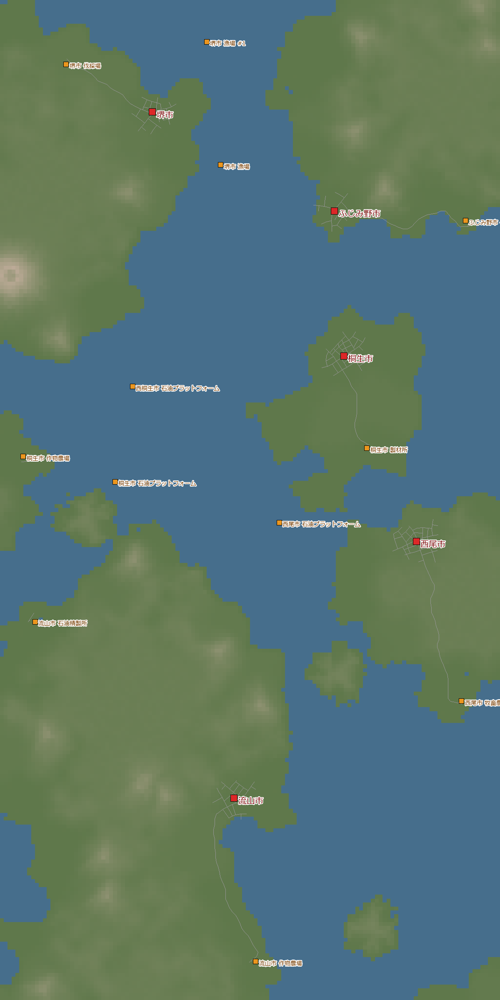
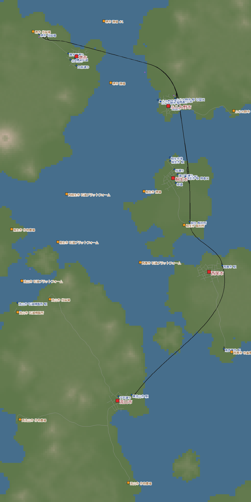
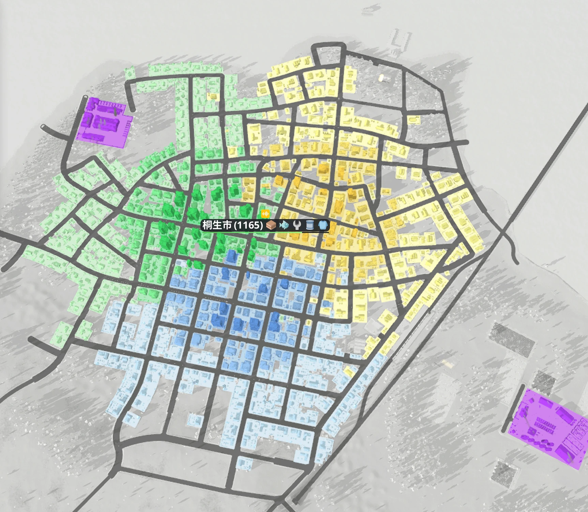
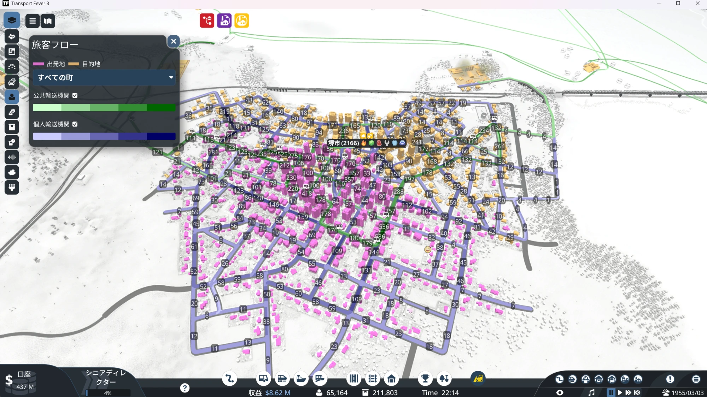
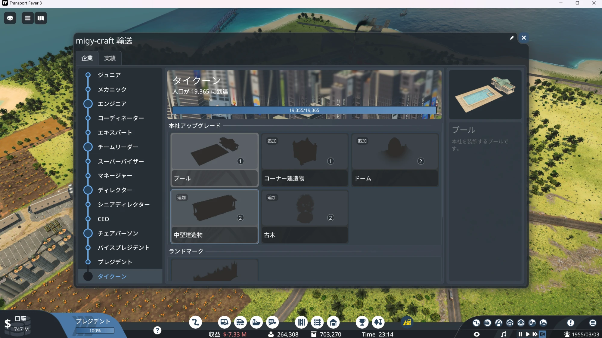
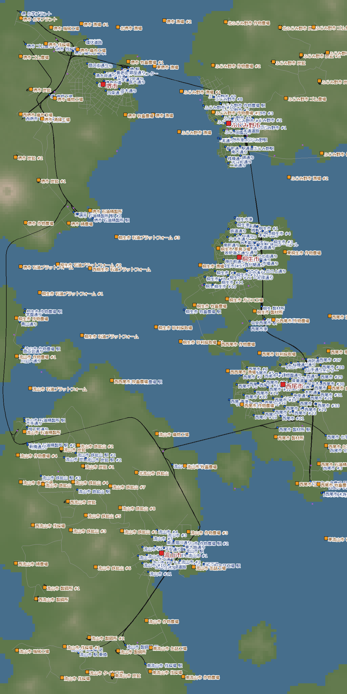

熱帯の多島海で、5 つの島の町を 1 本の幹線でつないでいった記録です。
1930 年に始めて、1955 年でカレンダーを止め、会社の最高位「タイクーン」まで遊びました。

## 目次
- [ワールドの設定](#settings)
- [1 日目 — 島をつなぐ 1 本の線路](#day1)
- [2 日目 — 石油プラットフォームと船](#day2)
- [3 日目 — カレンダーを止める](#day3)
- [4 日目 — 特典で汚染を下げる](#day4)
- [5 日目 — 立ち往生と渋滞、そしてタイクーン](#day5)
- [6 日目 — 実績の取り残しを拾う](#day6)
- [振り返り](#retro)

## ワールドの設定

| 項目 | 設定 |
|---|---|
| 気候 | 熱帯 |
| マップ | 中（8 × 16 km）。5 つの町がみんな別の島 |
| 町・産業 | まばら（町 5・産業 12） |
| 難易度 | ノーマル相当（カスタム） |
| 開始 | 1930 年 |
| 目的 | まだ遊んでいない熱帯で遊ぶ（実績 Globetrotter）・タイクーン |

熱帯には、ここにしか無い産業があります。
ゴム農場 → タイヤ工場 → 車両工場 の流れです。
逆に、飲料・書籍・セメント・粘土・紙などは出てきません。
原油は陸の油井ではなく、海の上の**石油プラットフォーム**から出ます。

{: width="420"}

## 1 日目 — 島をつなぐ 1 本の線路（1930〜1933）

最初の稼ぎは木材です。
伐採場 → 製材所 → 桐生 → ふじみ野 と走る列車を 2 本出しました。
蒸気機関車にステーク車 10 両の編成で、年 +$7.9M。

並行して、漁場からふじみ野の港へ船を 2 隻。
魚を届ける補助金が 2 つ出ていて、両方とも達成できました。

1933 年には、都市間の線路 1 本が完成しました。
堺の島 → ふじみ野 → 桐生 → 西尾 → 流山 と、5 つの島を南北に貫く幹線です。

{: width="420"}

> **分かったこと**
> - 町の並びが南北に素直だと、幹線を 1 本、丁寧に作れる。「あとで直す」前提の線路を作らずに済んだ
> - 新線は最初から複線にして、信号は敷いた日に全部「一方通行」にしておく

## 2 日目 — 石油プラットフォームと船（1934〜1942）

板・魚・野菜・燃料と、町が欲しがるものを順に運びました。

燃料の元の原油は、海の上の石油プラットフォームから出ます。
船で精製所へ運び、精製所から西尾へも船 7 隻で燃料を届けました。
石油プラットフォームにヘリコプターを降ろして、実績 Offshore も取れました。

野菜はトラック 12 台と列車 2 本。
途中で堺の島に新しい精製所ができたので、堺の燃料はそこから出すように組み替えました。

> **分かったこと**
> - 船は「線路を通せない海をまたぐ所」だけに絞るほうがいい。大きな港を最初から作るのは面倒で、大量・ゆっくりの輸送はあまり活きなかった

## 3 日目 — カレンダーを止める（1955）

1955 年で、カレンダー（日付の進み）を止めました。
年は進まないまま、町と輸送だけが動き続けます。
その時代の蒸気機関車やディーゼルを、急かされずにゆっくり楽しめるのがよかったです。

ふじみ野では、板と魚をトラムで町の中へ配りました。
ところが板が思ったほど届きません。
調べると、停留所の範囲に入っていた倉庫が、板を全部受け取っていました。
倉庫を範囲から外すと、板の供給が 44% → 82% に上がりました。

> **分かったこと**
> - 停留所の範囲に倉庫があると、届けたい荷物を倉庫が先に取ってしまう

## 4 日目 — 特典で汚染を下げる（1955）

町が伸びなくなってきたので、町ごとに「伸びを止めている評価」を見ました。
多くの町で、加工工場の汚染が足を引っ張っていました。

会社の位が上がるともらえる特典で、汚染を下げにかかりました。
- **産業の緑化**: 1 つの産業の汚染を −80%。桐生の家具工場と流山の缶詰工場に使いました
- **汚染除去施設**: 建設 $220M、1 期ごとの維持費 $10M。堺に建てたものの、堺の汚染は 31% → 33% とほとんど変わらず、取り壊しました

> **分かったこと**
> - 特典は、値段と効く範囲を確かめてから使う。緑化（−80%）のほうがずっと安くて確実

## 5 日目 — 立ち往生と渋滞、そしてタイクーン（1955）

方針を「初期の貨物を全部そろえてから加工」から「加工を先に」に変えました。
旅客列車「堺 - ふじみ野」も始めました。5 つの駅を往復する列車で、年 +$17.9M の黒字です。

一晩放置すると、人口は 9,648 → 16,244 人、口座は $331M → $1,079M に増えていました。

### 鉄道の立ち往生

勢いに乗って、列車を 17 両から 23 両に一気に増やしました。
すると午後、2 時間近く、鉄道の大半が駅に着かなくなりました。
口座は $1,057M → $672M。約 $385M が消えました。
折り返しの多い駅（堺 6 路線・流山 5 路線）で詰まったようです。
旅客列車を 2 本売って、ようやく動き出しました。

### 桐生の渋滞

今度は町の中が渋滞して、トラックが走れなくなりました。
桐生の渋滞の評価は 29% まで落ちていました。

原因は、島と島を結ぶ道路を作ったことでした。
隣の町へ行く人が、車で行こうとして町の中にあふれていたのです。
道路を切って、町と町の間は列車でしか行き来できないようにしました。

| 桐生 | 道路を切る前 | 切ったあと |
|---|---|---|
| 渋滞の評価 | 29% | 96% |
| 公共交通の利用 | 28% | 56% |
| 町の伸びの段 | 1 | 2 |

### タイクーン

会社の位は、世界の人口で上がります。
このワールドのタイクーンは「人口 19,365 人」。
23 時 14 分、ついに届きました。実績 Career Ladder です。

> **分かったこと**
> - 列車は 1 本ずつ足して、足すたびに様子を見る。一気に増やすと、折り返しの駅で詰まる
> - 町と町を道路でつなぐと、隣の町へ行く自家用車で町の中が渋滞する。町と町は列車や船で結び、都市間の道路は切ってしまうほうがいい
> - タイクーンに要る人口はワールドごとに違う（はじめの人口で決まる）。最初の日に会社のウインドウで目標を見ておく

## 6 日目 — 実績の取り残しを拾う

タイクーンのあとは、実績を拾いました。

- **Passenger Pioneer**（乗客を合計 100 万人）: これまでのワールドの合計で達成。ワールドをまたいで数えてくれます
- **Master Salesman**（どの気候でも出る貨物を全種類届ける）: 残りは熱帯にしか無いタイヤと、車両の 2 つでした。ゴム → タイヤ工場 → 車両工場 と運び、車両を町へ届けて達成

{: width="420"}

## 振り返り

### 楽しかった
- 島と島をつなぐ、という目標が分かりやすかった
- 町の並びがよく、1 本の幹線を丁寧に作れた
- カレンダーを止めて、時代の機関車をゆっくり楽しめた
- 数字を書き出して、町ごとに何が足りないかを見ながら遊べた

### 次に活かすこと
- 町と町は道路でつながない（都市間の道路は切る）
- 列車は 1 本ずつ足す
- 最初の日に、タイクーンに要る人口を見ておく
- 町が二次加工品を欲しがったら、一次産品を市内配送より加工施設へ回すほうを優先する（つい市内配送を充実させたくなるけれど）

次は乾燥帯をイージーで。まだ見ていない動物（クーガー・ワシ）も探します。
