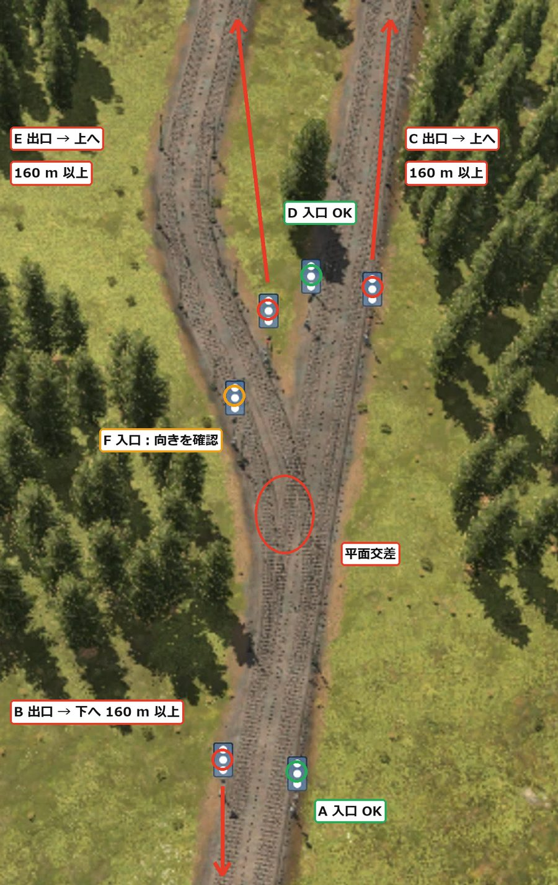
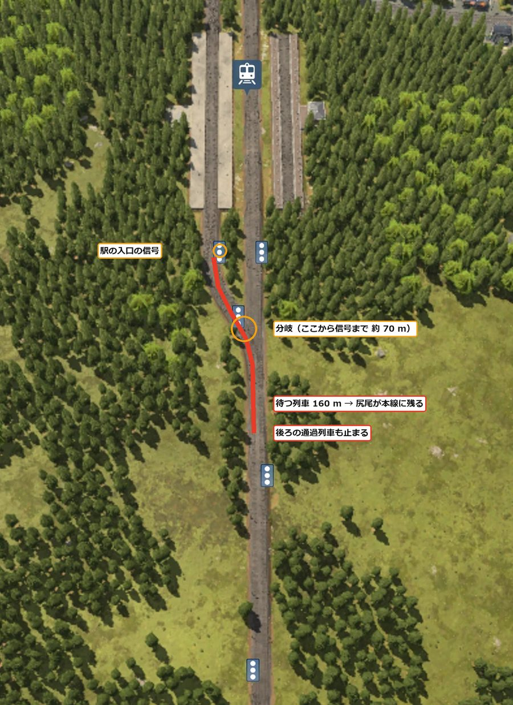
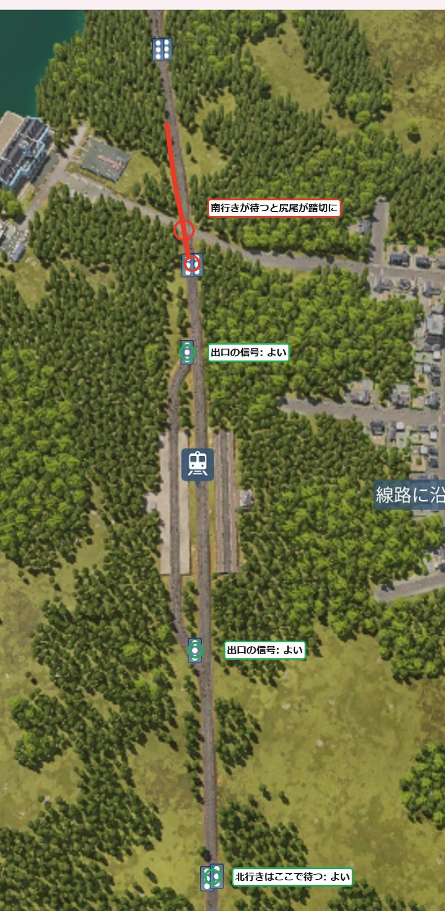

**日本語** · [English](en/tottori.html) · [Deutsch](de/tottori.html) · [中文](zh/tottori.html) · [한국어](ko/tottori.html)

亜寒帯の大きな湖のまわりに並んだ 5 つの町を、列車でつないでいく記録です。
1960 年に始めました。今回の一番の目標は、前回いちばん困った「長い編成で線路が詰まる」を起こさない駅と信号の作り方を身につけることです。

## 目次
- [ワールドの設定](#settings)
- [1 日目 — 駅と信号の型を考え直す](#day1)

## ワールドの設定

| 項目 | 設定 |
|---|---|
| 気候 | 亜寒帯 |
| マップ | 中（8 × 16 km）。真ん中に大きな湖 |
| 町・産業 | まばら（町 5・産業 12） |
| 難易度 | イージー（車両・建設・維持費が半分）。町の評価の感度はオフ |
| 開始 | 1960 年 |
| 目的 | 3 つ目の気候でタイクーン・列車を詰まらせない運用・列車での通勤と乗り換え |

町は 5 つとも湖の西から南の岸に、北西から南東へ 1 列に並んでいます。
産業の多くは湖の東側です。南西には高さ 200〜298 m の山地があります。

## 1 日目 — 駅と信号の型を考え直す（1960〜1961）

### 編成の長さを先に決める

前回のヤチヨで一番困ったのは、長い編成の詰まりでした。
160 m のホームに約 205 m の編成を入れていて、はみ出した尻尾が分岐を塞ぎ、主な産業が止まってしまいました。

最初は「ホーム 240 m・信号の間隔 300 m 以上」で作る案を立てました。
でも、それだと平らな土地がたくさん要ります。山と湖の多いこの地図では無理があります。

そこで、編成のほうを短く固定することにしました。

- 編成は全線 160 m のホームに収まる長さ（約 3,000 kW の機関車＋10〜11 両で、年に約 150 運べる）
- 駅の用地は 400 m（ホーム 160 m＋両端の分岐に 110 m ずつ）を見ておく
- 足りない分は、編成を長くせず本数で増やす
- 旅客も短い編成を本数で走らせて、頻度を上げる

### 分岐の信号

複線の幹線から、駅へ向かう線路を左へ分岐させました（右側通行）。
分岐の手前の信号は、分岐の直前に置けば正しい置き方です。
気をつけるのは分岐の先の信号です。分岐を抜けてすぐの所に置くと、そこで止まった列車の尻尾が分岐の上に残ります。
その間は、反対向きの列車も分岐を通れません。分岐の先の信号は、編成の長さ（160 m）以上離して置きます。

{: width="420"}

### 駅の前後に長い直線は要るのか

駅の前後に長い直線を取っていましたが、もっとコンパクトに作りたい。
考えてみると、長さが要るのは「信号の前で待つ列車の尻尾が、ほかの列車の通る分岐にかかるとき」だけでした。
待つ場所は曲がっていても、坂でもかまいません。

駅の両端の分岐（両渡り 40 m＋合流 70 m）は、入口の信号より先にあります。
なので、待つ場所の長さには数えられません。

秦野の駅で、分岐をホームのすぐ近くまで寄せてみました。
すると、ホームの手前の信号から分岐までが約 70 m しかありません。
ホームに前の列車がいると、次の列車はこの信号で待ちます。160 m の編成の尻尾が分岐を越えて本線に残り、後ろの通過列車まで止まってしまいます。

{: width="420"}

### 入口に信号を置かない

秦野の駅はもともと 2 面 2 線なので、空いているほうのホームに入れれば待つ列車は出ません。
そこで、信号の置き方を変えました。

- これまで: 駅の両端の両渡り分岐の手前に、それぞれ信号を置いていた
- 今回: 右側通行で駅を出る側、出口の分岐の直前にだけ信号を置く。入口には置かない（互い違い）

駅に入る列車は、ひとつ手前の閉塞の信号で待ちます。そこなら尻尾は駅の分岐にかかりません。
進むときには、空いているほうのホームを選んで入ります。
駅を出る列車は、出口の信号のところでホームの中に止まって待つので、本線を塞ぎません。

{: width="420"}

1 つだけ、北の信号で南行きが待つと、尻尾が道路の踏切にかかります。
その間は車が通れませんが、問題になってから立体交差にすることにしました。

> **分かったこと**
> - 編成の長さを先に決めると、ホームと用地の長さが決まる。長くするより本数で増やすほうが、土地が少なくて済む
> - 分岐の先の信号は、編成の長さ以上離す。止まった列車の尻尾が分岐に残ると、反対向きも止まる
> - 長さが要るのは、待つ列車の尻尾がほかの列車の通る分岐にかかるときだけ。待つ場所は曲線でも坂でもよい
> - 2 面 2 線の途中駅は、入口に信号を置かず出口の直前だけにすると、短く作れる。手前の信号の後ろに分岐と踏切が無いかは見ておく
> - 信号は、列車が通り過ぎた区間をすぐ空けて、ほかの列車を通す動きだと見て考えている（まだ確かめていない）
