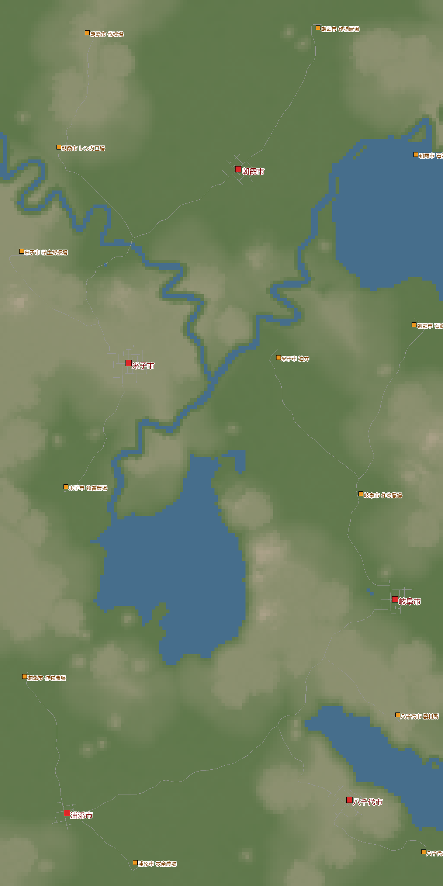
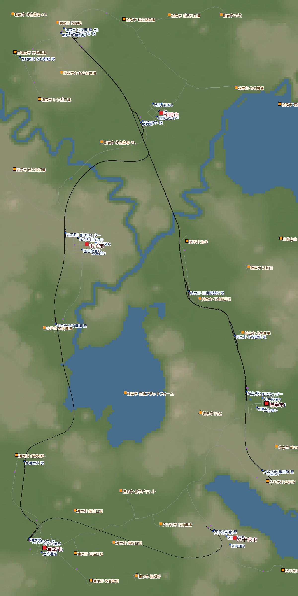
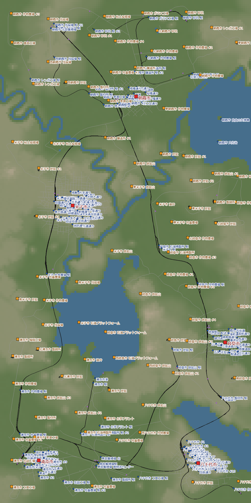

**日本語** · [English](en/yachiyo.html) · [Deutsch](de/yachiyo.html) · [中文](zh/yachiyo.html) · [한국어](ko/yachiyo.html)

乾燥帯の台地と低地に散らばった 5 つの町を、木材の幹線 1 本と集積場でつないでいった記録です。
1950 年に始めて、1 度やり直し、1985 年に会社の最高位「タイクーン」に届きました。実時間で 4 日です。

## 目次
- [ワールドの設定](#settings)
- [1 日目 — 口座がマイナスになって、やり直す](#day1)
- [2 日目 — 木材の幹線と集積場](#day2)
- [3 日目 — 町ごとに伸びを止めているものを外す](#day3)
- [4 日目 — 放置して、タイクーン](#day4)
- [振り返り](#retro)

## ワールドの設定

| 項目 | 設定 |
|---|---|
| 気候 | 乾燥帯 |
| マップ | 中（8 × 16 km）。湖・川・山 普通 |
| 町・産業 | まばら（町 5・産業 13） |
| 難易度 | イージー（車両・建設・維持費が半分） |
| 開始 | 1950 年 |
| 目的 | まだ遊んでいない乾燥帯で遊ぶ・タイクーン（人口 19,415） |

乾燥帯には、セメント工場・漁場・製紙所・タイヤ工場などがありません。
地形は高さ約 165 m の台地と、約 14 m の低地の 2 段です。
米子と八千代は台地の上、ほかの 3 つの町は低地にあります。

{: width="420"}

## 1 日目 — 口座がマイナスになって、やり直す（1950〜1951）

私の遊び方は、だいたい決まっています。
1. 序盤は、儲かりやすい「木材 → 製材所」か「原油 → 燃料」の線を敷く
2. それを幹線として丁寧に工事し、タイクーンのあたりまで使い続ける

今回もそうしようと、北の端の伐採場と南の製材所を結ぼうとしました。
ところが、融資のお金を全部つぎ込んでも足りず、資金が尽きてしまいました。
台地と低地の高低差があって、思っていたよりずっと高くついたのです。

ブルドーザーで線路を撤去しても、戻ってくるのは一部だけ。
お金は元の半分近くまで減ってしまいました。

仕方なく、近くの粘土 → レンガをつないで町に配りました。
でも、序盤の開発資金が足りず、できることが少なすぎます。
労働者を運ぶ補助金も、路線が無いまま受けて失敗し、罰金で口座は −$19.8M に。

ここで、同じシードで 1950 年からやり直すことにしました。

> **分かったこと**
> - 高低差のある所に線路を敷くと、思ったよりずっと高い。長い幹線は、敷く前に費用を見積もる
> - 線路を撤去しても、建てたお金は半分ほどしか戻らない
> - 補助金の前払いは稼ぎではない。条件を満たす路線が動いてから受ける

## 2 日目 — 木材の幹線と集積場（1950〜1955）

やり直しでは、北の伐採場から南東の製材所まで、木材の線を通しました。
今度は高さをそろえて直線でつなぐのではなく、工事費の安い所を選んでつなぎ、ぐねぐねの幹線にしました。
これを**幹線**にして、地域ごとの産業を**集積場**に集めてから幹線に載せます。
線路の規格も安いものを選びました。

台地と低地の高低差が大きく、八千代と岐阜の間の谷に橋を通すのは、とてもお金がかかりました。
それでもイージーなので、設備を少し雑に置いても攻略にはあまり響きません。

1950 年開始なので、今回は馬車からではありません。
最初からトラックと電化した線路で進められます。輸送力もスピードもある機関車たちが頼もしかったです。

1955 年には、口座 $262M・融資 0。路線は 27 本になりました。
稼ぎ頭は木材+野菜の列車（年 +$9.0M）と、旅客の朝米線（朝霞 - 米子、年 +$6.2M）です。

{: width="420"}

### 線路を敷くときの方針

前々回のワールドでは、インフレの時期に路線を黒字にできず、じり貧になってあきらめました。
原因は設備費でした。少しお金があるからと、高規格や標準規格の線路、倉庫をぜいたくに敷いた結果です。
なので前回と今回は慎重にしました。

貨物は、運ぶ速さで運賃が変わりません。
時速 160 km などの速さを保つのは、旅客だけでいい。
そこで、線路を敷く基準をはっきり分けることにしました。

- 何でもかんでも標準規格にはしない
- 小麦・粘土・砂・鉄・石炭などは量が欲しいので、近くても（できれば）列車にする
- 倉庫を足す前に、配送トラックを速く巡回させて、ため込みすぎない形にできないか考える
- 駅前はトラックターミナルなどにして、道路を敷かない
- 集積場を作り、そこにたくさんの列車やトラックを出入りさせる
- 町の中の路線は貨物ごとに分けすぎない。積む場所と配る先を工夫して、どの貨物が来ても同じ路線・同じ編成で運べるようにする
- 自家用車がじゃまなので、一般の車が通る町の幹線道路とはつなげない

### 貨物列車で労働者も運ぶ

最初につなぐ一次産業（伐採場や農場など）は、生産を伸ばしたいので、労働者を送ることもセットで考えます。
近くの町とバスでつなぐとうまくいくのですが、今回は最初から、貨物列車の先頭に客車をつないで一緒に運ぶことに挑戦しました。

やり方は、1 つのホームに旅客と貨物の両方を入れて、路線の停車駅にそれぞれのホームを順番に設定する、というものです。
でも、路線が複雑になります。
しかも幹線でこれをやると、終点の人が折り返すために乗り越したりして、あまりうまくいきませんでした。
結局、労働者の通勤はうまく運べないまま、タイクーンに着きました。

> **分かったこと**
> - 長い幹線を 1 本、先に通すと、集積場をぶら下げるだけで網が広がる
> - 野菜・板・燃料・肉・レンガは、これで十分に作れて運べた
> - 貨物の線は安い規格で。速さにお金をかけるのは旅客だけ
> - 貨物列車に客車をつないで労働者を運ぶ形は、路線が複雑になり、幹線では乗り越しも起きる。通勤は別の形を試したい

## 3 日目 — 町ごとに伸びを止めているものを外す（1966〜1967）

1966 年、人口 10,551 人・口座 $2.02B。
人口の伸びは、1955 年の約 2.8 倍になっていました。

町は、一番低い評価で伸びが止まります。町ごとに見ていくと、止めているものがばらばらでした。

| 町 | 伸びを止めていた評価 | 打った手 |
|---|---|---|
| 岐阜 | 渋滞（自家用車が町の真ん中の通りにあふれる） | 路面電車を 2 本に分けて、西半分にも通す |
| 岐阜・八千代 | 町の手入れ | 切れていた岐阜 - 八千代のメイン接続を戻す |
| 八千代 | 渋滞 | 南半分に旅客の路面電車 |
| 朝霞 | 汚染 | ランドマークを全部ここに置くと決めた |

岐阜の渋滞の評価は 0.42 → 0.74、公共交通の利用は 0.09 → 0.26 に上がりました。
伸びは 1 時間に約 635 人になり、このワールドで一番の速さでした。

ランドマークは、海事博物館のほかは全部「石」が要ります。
材料の産地が地図に無くても大丈夫。ランドマークを建てると、しばらくして要る材料の生産施設が新しくできます。

### 渋滞をどうするか

いまのところの考えです。

1. **雑な手として、町と町の接続を切る**。成長は止まるけれど、ペナルティはそれほど重くない。輸送網を整理して渋滞を解いてから、つなぎ直してもよさそう
2. **2 車線の道路をバスレーンにする**。一般の車はそこを通れず、建物にも影響しない。立ち往生しているトラックや路面電車を、とりあえず進ませたいときによさそう
3. 根本の手は公共交通を整えることしか無いと思う。でも、どうすればうまくいくのかは、まだよく分かっていない

汚染や騒音は、配送をどんどん進めて品物を十分に届ければ、それほど文句は言われません。
配送をこれ以上チューニングできない、となってから考えればよさそうです。
とはいえ、最初から次のことは意識しておくとよさそうです。
- 駅は住宅街ではない所に置く
- 町と町をつなぐ道路、町の幹線になる道路、区画を、簡単にでも整えておく。路面電車の線路をすっきり敷けるように

> **分かったこと**
> - 渋滞は自家用車。トラックを減らすのではなく、旅客の路線で公共交通の利用を上げる
> - 町の手入れが急に下がったら、町と町のメイン接続が切れていないか見る

## 4 日目 — 放置して、タイクーン（1968〜1985）

1969 年からは、ほぼ放置で進めました。
米子に貨物の新線を入れた年から、米子の騒音と渋滞が悪くなり、伸びは 1 時間に約 230 人まで落ちました。
それでも 1985 年に人口 19,233 人。あと 182 人です。

そして、人口 19,415 人。タイクーンになりました。
08 の熱帯に続いて、2 つ目の気候でのタイクーンです。

{: width="420"}

ただ、放置している間に困ったことも起きていました。
長い編成が駅の手前で詰まり、主な生産施設が止まって、たくさん閉業していました。
1967 → 1985 年の間に、産業は 29 消えて、27 新しくできています。

> **分かったこと**
> - ホームより長い編成を走らせると、尻尾が分岐にかかって後ろの列車を止める。止まった先の産業は閉業する
> - 伸びの残りのネックは市内配送。町の外の輸送が整っても、倉庫から町の中へ配る路線が足りないと、倉庫に荷物がたまる

## 振り返り

### 楽しかった
- 木材の幹線に集積場をぶら下げる形で、網がきれいに広がった
- 台地と低地の高低差に苦労しながら、谷に橋を架けてつないだ
- イージーなので、置き方を気にしすぎずに遊べた
- 1950 年開始で、最初からトラックと電化路線。頼もしい機関車たちで始められた

### 次に活かすこと
- 長い幹線は、敷く前に費用を見積もる（高低差は高くつく）
- 貨物の線は安い規格で。速さにお金をかけるのは旅客だけ
- 補助金は、条件を満たす路線が動いてから受ける
- 幹線と集積場ができたら、市内配送を先に整える
- 線ごとに一番長い編成を最初に決め、ホームは 240 m、信号の間隔と駅の手前の待ち場所は 300 m 以上にする
- 序盤から、列車で労働者を通勤させ、乗り換えて産業まで運ぶ形を成功させる

次は亜寒帯。町の評価の感度をオフにした「人口がすごく伸びる設定」で遊びます。
これまでホームは 160 m を基本にしてきましたが、新幹線 0 系は 8 両で 200 m を超えます。
なので次は最初から 200 m 級を前提に、240 m のホームと、長い電車やトラムを詰まらせない運用を身につけます。
ランドマーク 10 個の Centralized と、高さ 500 m を超える駅の Summit Stopover も狙います。
