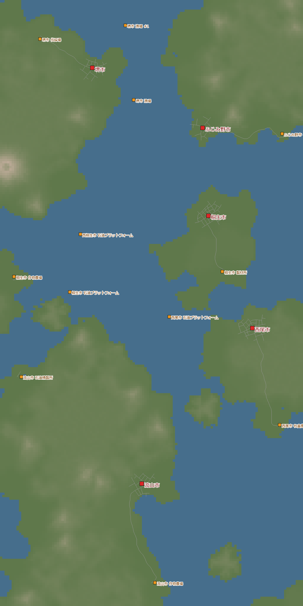
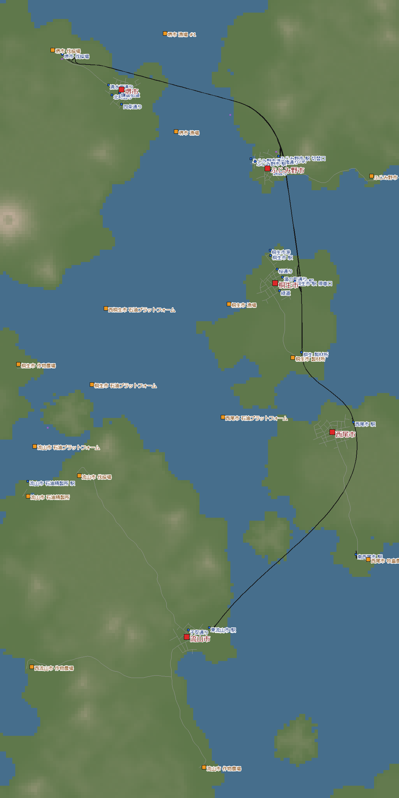
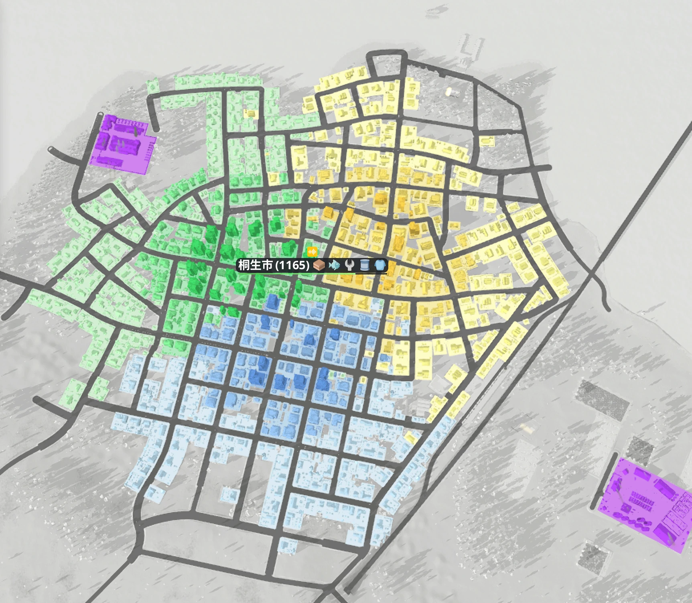
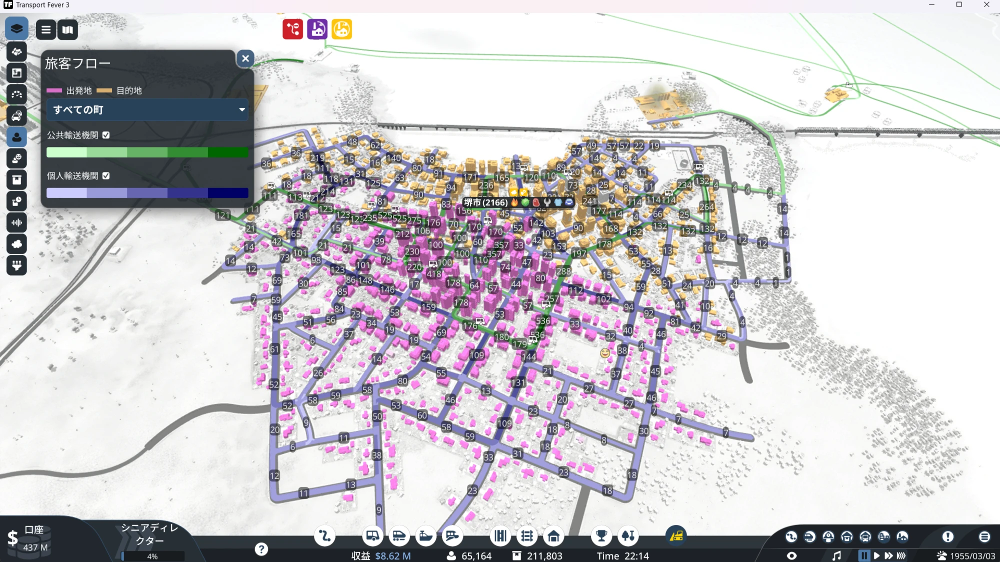
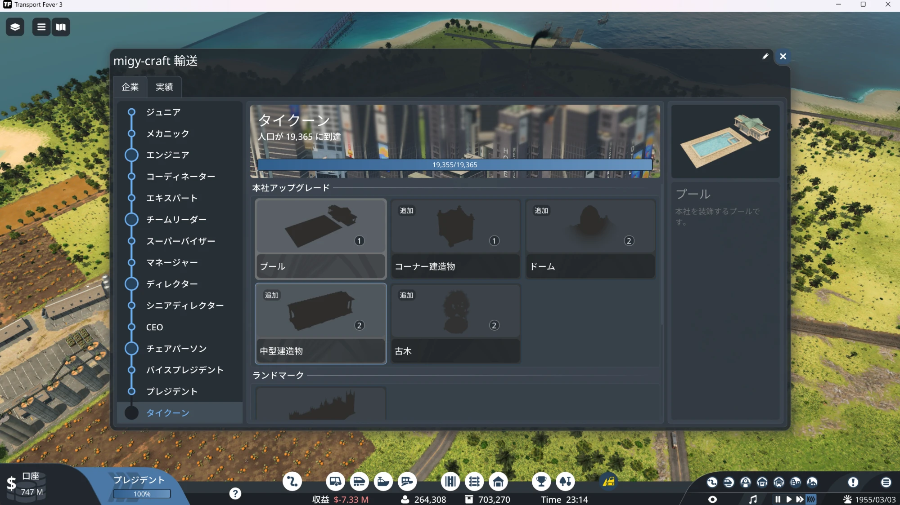
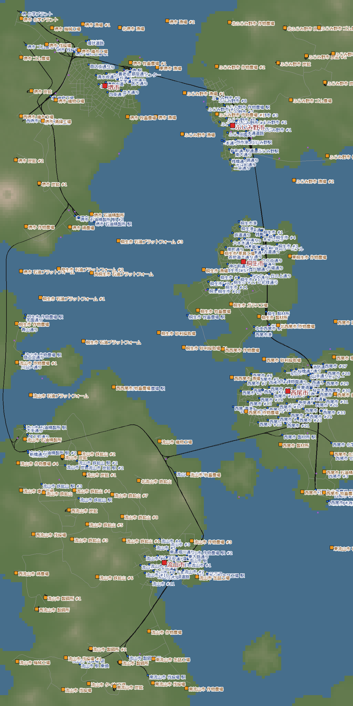

[日本語](../nagareyama.html) · [English](../en/nagareyama.html) · [Deutsch](../de/nagareyama.html) · **中文** · [한국어](../ko/nagareyama.html)

这是在热带多岛海上，用 1 条干线把 5 座岛上的城镇连起来的记录。
1930 年开始，到 1955 年停止日历，一直玩到公司最高等级“大亨”。

## 目录
- [世界设置](#settings)
- [第 1 天 — 连接各岛的 1 条铁路](#day1)
- [第 2 天 — 采油平台与船](#day2)
- [第 3 天 — 停止日历](#day3)
- [第 4 天 — 用特权降低污染](#day4)
- [第 5 天 — 堵车、拥堵，然后是大亨](#day5)
- [第 6 天 — 捡回遗漏的成就](#day6)
- [回顾](#retro)

## 世界设置

| 项目 | 设置 |
|---|---|
| 气候 | 热带 |
| 地图 | 中（8 × 16 km）。5 座城镇各在不同的岛上 |
| 城镇・产业 | 稀疏（城镇 5・产业 12） |
| 难度 | 相当于普通（自定义） |
| 开始 | 1930 年 |
| 目的 | 去还没玩过的热带（成就 环球旅行者）・大亨 |

热带有只在这里才有的产业。
流程是 橡胶农场 → 轮胎厂 → 汽车厂。
相反，饮料、书籍、水泥、黏土、纸之类不会出现。
原油不是来自陆地上的油井，而是来自海上的**采油平台**。

{: width="420"}

## 第 1 天 — 连接各岛的 1 条铁路（1930〜1933）

最初的收入来源是木材。
我开了 2 列火车：伐木营地 → 锯木厂 → 桐生市 → 富士见野市。
编组是蒸汽机车加 10 节立柱平车，每年 +$7.9M。

同时，从渔场往富士见野市的港口派了 2 艘船。
运鱼的补贴有 2 个，两个都完成了。

1933 年，1 条城际铁路建成了。
堺市的岛 → 富士见野市 → 桐生市 → 西尾市 → 流山市，是一条南北贯穿 5 座岛的干线。

{: width="420"}

> **明白了什么**
> - 城镇的排列在南北方向很顺，就能认真做好 1 条干线。不用修那种“以后再改”的铁路了
> - 新线路一开始就修成复线，信号在铺设当天就全部设成“单向”

## 第 2 天 — 采油平台与船（1934〜1942）

厚木板、鱼、蔬菜、燃料，按城镇想要的东西依次运送。

燃料的原料原油来自海上的采油平台。
用船运到炼油厂，再从炼油厂用 7 艘船把燃料送到西尾市。
我还让直升机降落在采油平台上，拿到了成就 离岸。

蔬菜用了 12 辆卡车和 2 列火车。
中途堺市的岛上建起了新的炼油厂，所以我把堺市的燃料改成从那里供应。

> **明白了什么**
> - 船最好只用在“铁路过不去的跨海地段”。一开始就建大港很麻烦，而大量・慢速的运输也没怎么发挥出来

## 第 3 天 — 停止日历（1955）

1955 年，我停止了日历（游戏内日期不再推进）。
年份不再前进，只有城镇和运输继续运转。
能不被催促、慢慢享受那个时代的蒸汽机车和柴油机车，感觉很好。

在富士见野市，我用有轨电车把厚木板和鱼送进城里。
可是厚木板没有送到预想的那么多。
一查才发现，站台范围内的仓库把厚木板全部收走了。
把仓库移出范围后，厚木板的供应率从 44% → 82%。

> **明白了什么**
> - 站台范围内如果有仓库，仓库会抢先拿走本来要送给城镇的货物

## 第 4 天 — 用特权降低污染（1955）

城镇渐渐不怎么增长了，所以我逐个城镇查看“拖住增长的评分”。
很多城镇里，加工厂的污染在拖后腿。

公司等级提升后会得到特权，我用它来压低污染。
- **产业环保化**：让 1 个产业的污染 −80%。用在了桐生市的家具厂和流山市的罐头工厂
- **污染消除设施**：建设费 $220M，每期维护费 $10M。我在堺市建了一座，但堺市的污染从 31% → 33%，几乎没变，就拆掉了

> **明白了什么**
> - 特权要先确认价格和生效范围再用。环保化（−80%）便宜得多，也更可靠

## 第 5 天 — 堵车、拥堵，然后是大亨（1955）

我把方针从“先把初级货物全部备齐再加工”改成了“先做加工”。
还开通了客运列车“堺市 - 富士见野市”。它在 5 个车站之间往返，每年盈利 +$17.9M。

放着过了一夜，人口从 9,648 → 16,244 人，账户从 $331M → $1,079M。

### 铁路堵车

趁着势头，我一口气把列车从 17 列增加到 23 列。
结果下午有将近 2 小时，大半铁路都到不了车站。
账户从 $1,057M → $672M，约 $385M 就这样没了。
似乎是在折返线路多的车站（堺市 6 条线・流山市 5 条线）堵住了。
卖掉 2 列客运列车后，终于动了起来。

### 桐生市的拥堵

这回是城里拥堵，卡车跑不动了。
桐生市的交通评分已经掉到了 29%。

原因是我修了连接岛与岛的道路。
想去邻近城镇的人想开车去，结果挤满了城里。
我把道路切断，让城镇之间只能靠火车往来。

| 桐生市 | 切断道路前 | 切断后 |
|---|---|---|
| 交通评分 | 29% | 96% |
| 公共交通使用率 | 28% | 56% |
| 城镇增长等级 | 1 | 2 |

### 大亨

公司等级由世界人口决定。
这个世界的大亨要求“人口 19,365 人”。
23 点 14 分，终于达到了。成就 职业阶梯。

> **明白了什么**
> - 列车一列一列地加，每加一次就看看情况。一口气加太多，会在折返车站堵住
> - 用道路连接城镇之后，开往邻近城镇的私家车会让城里拥堵。城镇之间用火车或船连接，把城际道路切断更好
> - 大亨所需的人口每个世界都不同（由起始人口决定）。第一天就在公司窗口里确认目标

## 第 6 天 — 捡回遗漏的成就

大亨之后，我去捡成就。

- **客运先锋**（累计运送乘客 100 万人）：靠之前各个世界的合计达成。它会跨世界累计
- **销售大师**（运送在任何气候都会出现的所有货物种类）：剩下的是只有热带才有的轮胎，和载具这 2 种。按 橡胶 → 轮胎厂 → 汽车厂 的流程运输，把载具送到城镇后达成

{: width="420"}

## 回顾

### 玩得开心的地方
- “把岛与岛连起来”这个目标很清楚
- 城镇的排列很好，能认真做好 1 条干线
- 停止日历后，可以慢慢享受那个时代的机车
- 把数字写出来，一边看每个城镇缺什么一边玩

### 下次要用上的
- 城镇和城镇之间不要用道路连接（切断城际道路）
- 列车一列一列地加
- 第一天就看好大亨所需的人口
- 城镇想要二次加工品时，比起市内配送，优先把初级产品送去加工设施（虽然总想把市内配送做充实）

下一次玩干燥气候，选简单难度。也要去找还没见过的动物（美洲狮・鹰）。
