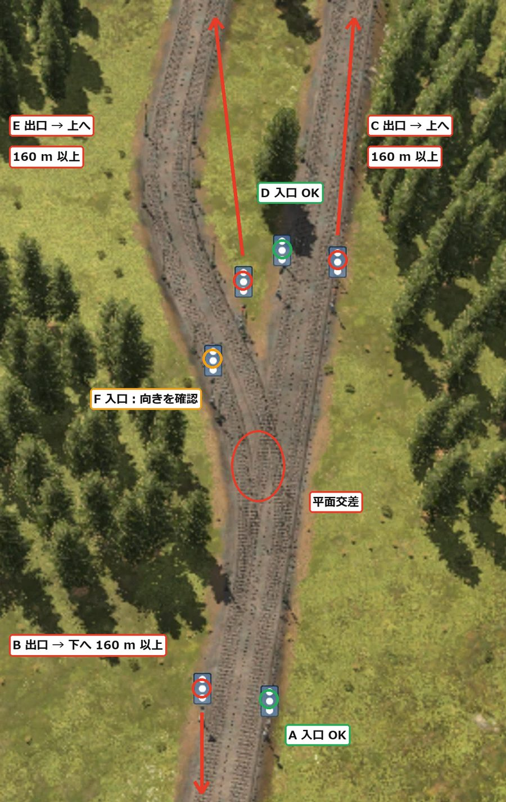
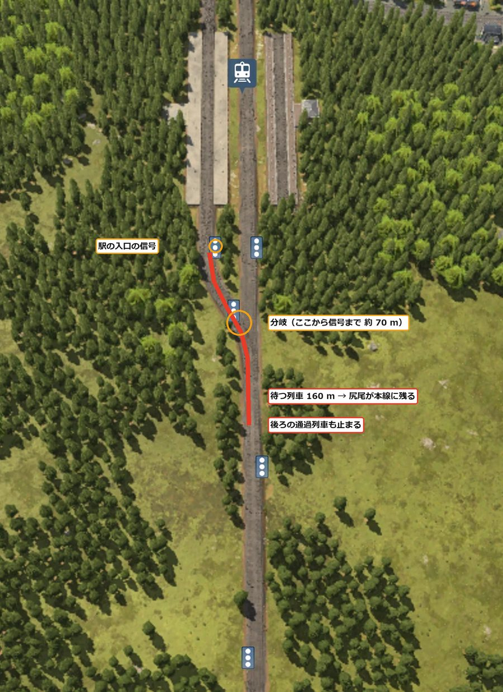
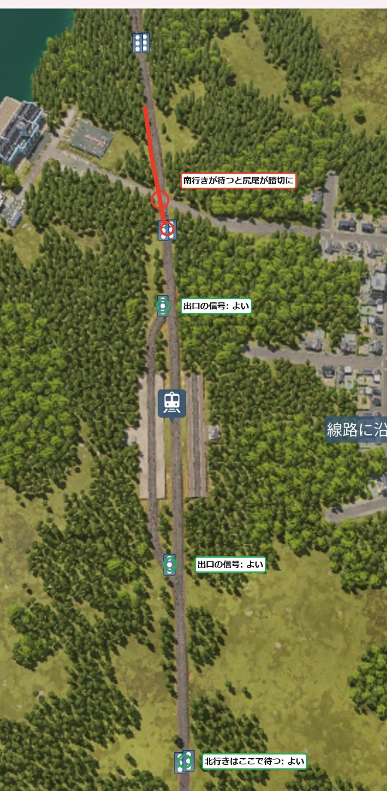

[日本語](../tottori.html) · [English](../en/tottori.html) · [Deutsch](../de/tottori.html) · **中文** · [한국어](../ko/tottori.html)

这是在亚寒带的大湖周围，用列车把排成一列的 5 座城镇连起来的记录。
1960 年开始。这次最大的目标，是学会一种车站和信号灯的建法，不再发生上次最头疼的“长编组堵住线路”。

## 目录
- [世界设置](#settings)
- [第 1 天 — 重新思考车站和信号灯的做法](#day1)

## 世界设置

| 项目 | 设置 |
|---|---|
| 气候 | 亚寒带 |
| 地图 | 中（8 × 16 km）。正中间有一个大湖 |
| 城镇・产业 | 稀疏（城镇 5・产业 12） |
| 难度 | 简单（载具・建设・维护费减半）。城镇评价的敏感度关闭 |
| 开始 | 1960 年 |
| 目的 | 第 3 个气候的大亨・不堵住列车的运营・用列车通勤和换乘 |

5 座城镇都在湖的西岸到南岸，从西北到东南排成一列。
产业大多在湖的东侧。西南有高 200〜298 m 的山地。

## 第 1 天 — 重新思考车站和信号灯的做法（1960〜1961）

### 先定编组的长度

上一次在八千代最头疼的，是长编组造成的堵塞。
我让约 205 m 的编组进 160 m 的站台，露出来的车尾挡住了道岔，主要产业就停了。

起初我打算按“站台 240 m・信号灯间隔 300 m 以上”来建。
但那样需要很多平地。在这张山和湖很多的地图上不现实。

于是我决定反过来，把编组固定得短一些。

- 编组要能放进全线 160 m 的站台（约 3,000 kW 的机车＋10〜11 节车厢，一年约能运 150）
- 车站的用地预留 400 m（站台 160 m＋两端的道岔各 110 m）
- 不够的部分不加长编组，靠增加班次来补
- 客运也用短编组增加班次，提高发车频率

### 道岔处的信号灯

我从复线干线向左分出一条通往车站的线路（右侧通行）。
道岔前的信号灯，只要放在道岔的正前方，就是对的放法。
要留意的是道岔之后的信号灯。如果放在刚过道岔的地方，停在那里的列车车尾就会留在道岔上。
这期间，反方向的列车也无法通过道岔。道岔之后的信号灯，要放在离道岔至少一个编组长度（160 m）的地方。

{: width="420"}

### 车站前后需要很长的直线吗

我之前在车站前后留了很长的直线，但想做得更紧凑。
想了想，需要长度的，只是“在信号灯前等待的列车，车尾压到其他列车要通过的道岔”的时候。
等待的地方弯着也行，有坡也行。

车站两端的道岔（交叉渡线 40 m＋合流 70 m）位于入口信号灯之后。
所以不算进等待处的长度。

在秦野市的车站，我试着把道岔挪到靠近站台的地方。
这样一来，从站台前的信号灯到道岔只有约 70 m。
站台上有前一趟列车时，后一趟就在这个信号灯前等待。160 m 编组的车尾越过道岔留在正线上，连后面的通过列车也被拦住了。

{: width="420"}

### 入口不放信号灯

秦野市的车站本来就是 2 个站台 2 条线，进入空着的站台就不会有等待的列车。
所以我改变了信号灯的放法。

- 以前：在车站两端的交叉渡线道岔前，各放一个信号灯
- 这次：只在右侧通行时列车出站的一侧，也就是出口道岔的正前方放一个信号灯。入口不放（交错）

进站的列车在前一个闭塞的信号灯前等待。在那里，车尾不会压到车站的道岔。
前进时，选择空着的站台进入。
出站的列车在出口信号灯处停在站台里等待，所以不会挡住正线。

{: width="420"}

只有一处，南行列车在北侧信号灯前等待时，车尾会压到道路的道口。
这期间汽车无法通过，但我决定等出了问题再改成立体交叉。

> **学到的事**
> - 先定编组长度，站台和用地的长度就定下来了。靠增加班次比加长编组更省土地
> - 道岔之后的信号灯，要离开至少一个编组长度。停下的列车车尾留在道岔上，反方向也会停
> - 需要长度的，只是等待列车的车尾压到其他列车要通过的道岔的时候。等待的地方弯着、有坡都可以
> - 2 站台 2 线的中间站，入口不放信号灯、只在出口正前方放，可以做得更短。要看前一个信号灯后面有没有道岔和道口
> - 我把信号灯理解为：列车一通过就立刻放空那一段，让其他列车通过（还没有确认）
