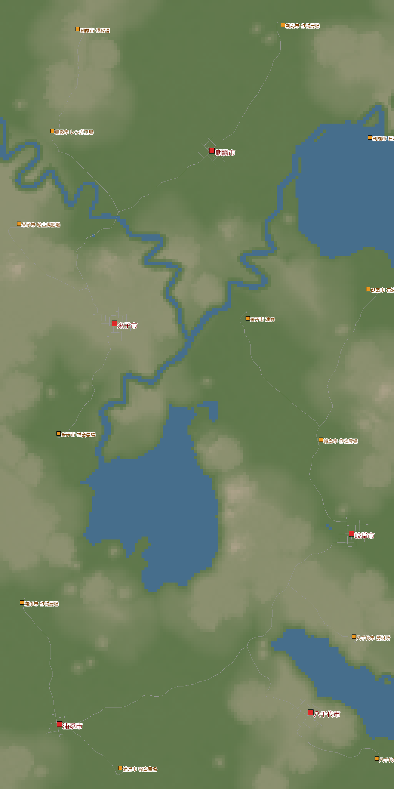
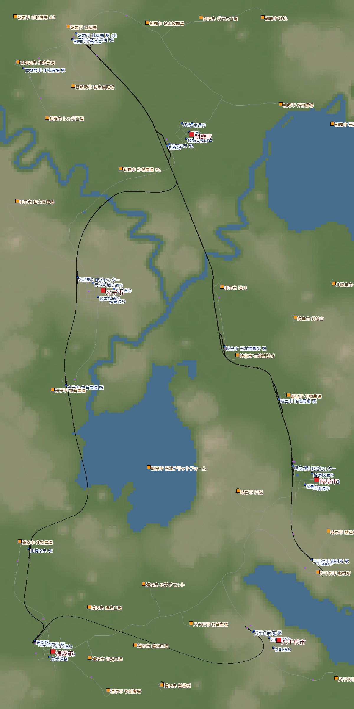
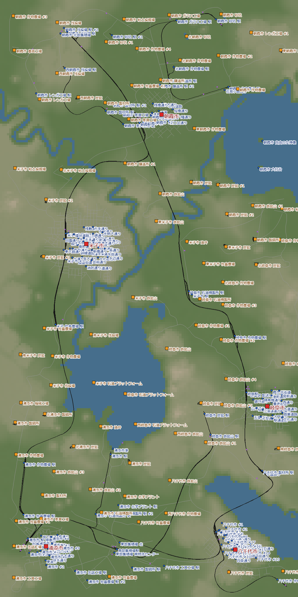

[日本語](../yachiyo.html) · [English](../en/yachiyo.html) · [Deutsch](../de/yachiyo.html) · **中文** · [한국어](../ko/yachiyo.html)

这是在干燥气候的台地和低地上，用 1 条木材干线和集货站把散布的 5 座城镇连起来的记录。
1950 年开始，重来了 1 次，1985 年达到了公司最高等级“大亨”。实际用时 4 天。

## 目录
- [世界设置](#settings)
- [第 1 天 — 账户变成负数，于是重来](#day1)
- [第 2 天 — 木材干线与集货站](#day2)
- [第 3 天 — 逐个城镇解除拖住增长的因素](#day3)
- [第 4 天 — 放着不管，达成大亨](#day4)
- [回顾](#retro)

## 世界设置

| 项目 | 设置 |
|---|---|
| 气候 | 干燥 |
| 地图 | 中（8 × 16 km）。湖泊・河流・山脉 中等 |
| 城镇・产业 | 稀疏（城镇 5・产业 13） |
| 难度 | 简单（载具・建设・维护费减半） |
| 开始 | 1950 年 |
| 目的 | 去还没玩过的干燥气候・大亨（人口 19,415） |

干燥气候里没有水泥厂、渔场、造纸厂、轮胎厂等产业。
地形分成 2 层：高约 165 m 的台地，和高约 14 m 的低地。
米子市和八千代市在台地上，其余 3 座城镇在低地。

{: width="420"}

## 第 1 天 — 账户变成负数，于是重来（1950〜1951）

我用起步资金开了粘土 → 砖石的货运列车，以及朝霞市 - 米子市的客运列车。
客运线路还做了电气化。

过了 2 年，账户变成 −$2.1M。
4 笔贷款全都借了，每月还款约 $0.78M（每年约 $9.4M）。
1 列火车每年只赚 $2.4〜3.6M，根本追不上。

我还去接了补贴。
预付款让账户看起来回到了 +$15M，
可我是在没有运送工人的线路的情况下接的，2 个都失败了。
罚款让账户变成了 −$19.8M。

于是我决定用同一个种子，从 1950 年重新开始。

> **明白了什么**
> - 一开始先比较贷款还款和 1 列火车的收入。客运和电气化等赚到钱以后再做
> - 补贴的预付款不是收入。等满足条件的线路跑起来以后再接
> - 贷款从每月还款较轻的“中”开始，一笔一笔地借

## 第 2 天 — 木材干线与集货站（1950〜1955）

重来之后，我努力打通了一条从北边伐木营地到东南锯木厂的木材线路。
把它当作**干线**，各地区的产业先汇集到**集货站**，再装上干线。
用简易轨道、不电气化，尽量便宜地铺设。

台地和低地的高差很大，在八千代市和岐阜市之间的山谷上架桥花了很多钱。
不过因为是简单难度，设施摆得稍微随便一点，对攻略也没什么影响。

到 1955 年，账户 $262M・贷款 0。线路有 27 条。
赚钱主力是木材+蔬菜的列车（每年 +$9.0M），和客运的朝米线（朝霞市 - 米子市，每年 +$6.2M）。

{: width="420"}

> **明白了什么**
> - 先打通 1 条长干线，只要往上挂集货站，网络就能铺开
> - 蔬菜・厚木板・燃料・肉类・砖石，用这个办法就足够生产和运输了

## 第 3 天 — 逐个城镇解除拖住增长的因素（1966〜1967）

1966 年，人口 10,551 人・账户 $2.02B。
人口增长速度已经是 1955 年的约 2.8 倍。

城镇会被最低的那个评分拖住增长。逐个城镇看下来，拖后腿的东西各不相同。

| 城镇 | 拖住增长的评分 | 采取的措施 |
|---|---|---|
| 岐阜市 | 交通（私家车挤满了城中心的街道） | 把有轨电车分成 2 条，也通到西半边 |
| 岐阜市・八千代市 | 城镇维护 | 恢复了断开的岐阜市 - 八千代市的主要连接点 |
| 八千代市 | 交通 | 在南半边开了客运有轨电车 |
| 朝霞市 | 污染 | 决定把地标全部建在这里（但是没有石料） |

岐阜市的交通评分从 0.42 → 0.74，公共交通使用率从 0.09 → 0.26。
增长达到每小时约 635 人，是这个世界里最快的。

地标除了船舶博物馆以外，全都需要“石料”。
这张地图上连 1 个采石场都没有，所以建不了。

> **明白了什么**
> - 交通拥堵来自私家车。不是减少卡车，而是用客运线路提高公共交通使用率
> - 城镇维护突然下降时，看看城镇之间的主要连接点有没有断开

## 第 4 天 — 放着不管，达成大亨（1968〜1985）

从 1969 年起，我基本上放着不管让它自己跑。
从往米子市接入货运新线的那年开始，米子市的噪音和交通变差，增长掉到每小时约 230 人。
即便如此，1985 年人口也到了 19,233 人。还差 182 人。

然后，人口 19,415 人。成了大亨。
继 08 的热带之后，这是第 2 个气候的大亨。

{: width="420"}

不过，放着不管的期间也出了麻烦。
长编组在车站前堵住，主要的生产设施停了下来，很多都倒闭了。
1967 → 1985 年间，有 29 个产业消失，新出现了 27 个。
站台基本按 160 m 修，可新干线 0 系列 8 节编组就超过了 200 m。

> **明白了什么**
> - 让比站台长的编组跑起来，车尾会压在道岔上，挡住后面的列车。被挡住的那头的产业会倒闭
> - 增长剩下的瓶颈是市内配送。即使城镇之外的运输都整顿好了，如果从仓库往城里配送的线路不够，货物就会堆在仓库里

## 回顾

### 玩得开心的地方
- 在木材干线上挂集货站的形式，让网络铺得很漂亮
- 一边为台地和低地的高差发愁，一边在山谷上架桥连起来
- 因为是简单难度，可以不太在意摆放，轻松地玩

### 下次要用上的
- 一开始先比较还款和收入，从赚钱的货运线路铺起
- 补贴等满足条件的线路跑起来以后再接
- 干线和集货站建好后，先把市内配送做好
- 每条线路一开始就定好最长的编组，站台修 240 m，信号间隔和车站前的等待区留 300 m 以上

下一次是亚寒带。用关掉城镇评分敏感度的“人口疯长设置”，学会 200 m 级编组的运营。
也要去拿建齐 10 个地标的成就 集中建设，和在海拔 500 m 以上车站停靠的成就 高峰停靠。
